# Class Diagram — RenTahanan

**Generated:** 2026-11-20  
**Purpose:** Proposed object-oriented structure for the PERN backend  
**Status:** Proposal — awaiting verification before implementation

---

## Mermaid Class Diagram

```mermaid
classDiagram
    %% ==================== ENUMS ====================
    class UserRole {
        <<enumeration>>
        OWNER
        CARETAKER
        TENANT
    }

    class RoomType {
        <<enumeration>>
        SINGLE
        DOUBLE
        QUAD
    }

    class BedStatus {
        <<enumeration>>
        VACANT
        OCCUPIED
        OVERDUE
    }

    class TenantStatus {
        <<enumeration>>
        ACTIVE
        MOVED_OUT
        FLAGGED_DEBT
    }

    class ContractStatus {
        <<enumeration>>
        ACTIVE
        COMPLETED
        TERMINATED
    }

    class BillingStatus {
        <<enumeration>>
        UNPAID
        PAID
        OVERDUE
    }

    %% ==================== DOMAIN ENTITIES ====================
    class User {
        +int userId
        +string username
        +string passwordHash
        +UserRole role
        +DateTime createdAt
        +DateTime updatedAt
        +verifyPassword(string) bool
    }

    class Room {
        +int roomId
        +string roomNumber
        +RoomType type
        +int capacity
        +int floorLevel
        +DateTime createdAt
        +DateTime updatedAt
        +List~Bed~ beds
    }

    class Bed {
        +int bedId
        +int roomId
        +string bedCode
        +BedStatus status
        +DateTime createdAt
        +DateTime updatedAt
        +Room room
        +Contract activeContract
    }

    class Tenant {
        +int tenantId
        +int? userId
        +string firstName
        +string lastName
        +string contactNumber
        +string emergencyContact
        +TenantStatus status
        +DateTime createdAt
        +DateTime updatedAt
        +User user
        +List~Contract~ contracts
        +List~BillingStatement~ billings
        +List~Payment~ payments
    }

    class Contract {
        +int contractId
        +int tenantId
        +int bedId
        +int? createdByUserId
        +Date startDate
        +Date endDate
        +Decimal monthlyRate
        +Decimal advanceRentPaid
        +Decimal depositPaid
        +ContractStatus status
        +DateTime createdAt
        +DateTime updatedAt
        +Tenant tenant
        +Bed bed
        +User createdBy
        +List~BillingStatement~ billings
    }

    class BillingStatement {
        +int billingStatementId
        +int contractId
        +int tenantId
        +Date billingDate
        +Date dueDate
        +Decimal amountDue
        +BillingStatus status
        +int overdueWarningCount
        +Date? evictionEligibleDate
        +DateTime createdAt
        +DateTime updatedAt
        +Contract contract
        +Tenant tenant
        +List~Payment~ payments
        +markOverdue() void
        +markPaid() void
        +isOverdue() bool
    }

    class Payment {
        +int paymentId
        +int? billingStatementId
        +int tenantId
        +int loggedByUserId
        +Decimal amountPaid
        +string orNumber
        +DateTime paymentDate
        +string? remarks
        +DateTime updatedAt
        +BillingStatement? billingStatement
        +Tenant tenant
        +User loggedBy
    }

    %% ==================== REPOSITORIES (Data Access) ====================
    class IRepository~T~ {
        <<interface>>
        +findById(int) T?
        +findAll() List~T~
        +save(T) T
        +delete(int) void
    }

    class UserRepository {
        +findByUsername(string) User?
        +findByRole(UserRole) List~User~
    }

    class RoomRepository {
        +findByFloor(int) List~Room~
        +findVacantBeds(int roomId) List~Bed~
    }

    class BedRepository {
        +findByStatus(BedStatus) List~Bed~
        +findVacantByRoomType(RoomType) List~Bed~
        +lockForUpdate(int bedId) Bed?
    }

    class TenantRepository {
        +findActive() List~Tenant~
        +findWithOutstandingBalance() List~Tenant~
    }

    class ContractRepository {
        +findActiveByTenant(int tenantId) Contract?
        +findActiveByBed(int bedId) Contract?
        +findExpiringSoon(int days) List~Contract~
    }

    class BillingRepository {
        +findUnpaidByTenant(int tenantId) List~BillingStatement~
        +findOverdue() List~BillingStatement~
        +findByContract(int contractId) List~BillingStatement~
    }

    class PaymentRepository {
        +findByOrNumber(string) Payment?
        +findByTenant(int tenantId) List~Payment~
        +findByBillingStatement(int billingId) List~Payment~
    }

    %% ==================== SERVICES (Business Logic) ====================
    class AuthService {
        +register(RegisterDTO) User
        +login(LoginDTO) AuthResult
        +hashPassword(string) string
        +verifyToken(string) TokenPayload?
    }

    class RoomService {
        +createRoom(CreateRoomDTO) Room
        +updateRoom(int, UpdateRoomDTO) Room
        +deleteRoom(int) void
        +getAllRooms() List~Room~
        +getRoomsByFloor(int) List~Room~
    }

    class BedService {
        +addBedToRoom(int roomId, string bedCode) Bed
        +updateBedStatus(int bedId, BedStatus) Bed
        +getVacantBeds() List~Bed~
    }

    class TenantService {
        +createTenant(CreateTenantDTO) Tenant
        +updateTenant(int, UpdateTenantDTO) Tenant
        +getTenantProfile(int) TenantProfileDTO
        +getOutstandingBalance(int tenantId) Decimal
    }

    class ContractService {
        +createContract(CreateContractDTO) Contract
        +terminateContract(int contractId) void
        +checkPayBeforeLeave(int tenantId) bool
        +getActiveContract(int tenantId) Contract?
    }

    class BillingService {
        +generateBilling(CreateBillingDTO) BillingStatement
        +checkOverdue() OverdueCheckResult
        +getTenantBillings(int tenantId) List~BillingStatement~
    }

    class PaymentService {
        +recordPayment(CreatePaymentDTO) Payment
        +validateExactPayment(Decimal amountPaid, Decimal amountDue) void
        +verifyOrUnique(string orNumber) bool
    }

    %% ==================== DTOs / VALUE OBJECTS ====================
    class RegisterDTO {
        +string username
        +string password
        +UserRole role
    }

    class LoginDTO {
        +string username
        +string password
    }

    class AuthResult {
        +string token
        +User user
    }

    class CreateRoomDTO {
        +string roomNumber
        +RoomType type
        +int capacity
        +int floorLevel
    }

    class CreateContractDTO {
        +int tenantId
        +int bedId
        +Date startDate
        +Date endDate
        +Decimal monthlyRate
        +Decimal advanceRentPaid
        +Decimal depositPaid
    }

    class CreateBillingDTO {
        +int contractId
        +Date dueDate
        +Decimal amountDue
    }

    class CreatePaymentDTO {
        +int? billingStatementId
        +int tenantId
        +Decimal amountPaid
        +string orNumber
        +string? remarks
    }

    class OverdueCheckResult {
        +int updatedCount
        +List~BillingStatement~ updated
    }

    class TenantProfileDTO {
        +Tenant tenant
        +Contract? activeContract
        +List~BillingStatement~ billings
        +Decimal outstandingBalance
    }

    %% ==================== RELATIONSHIPS ====================
    User "1" --> "0..1" Tenant : userId
    Room "1" --> "*" Bed : roomId
    Bed "1" --> "0..1" Contract : activeContract
    Tenant "1" --> "*" Contract : tenantId
    Tenant "1" --> "*" BillingStatement : tenantId
    Tenant "1" --> "*" Payment : tenantId
    Contract "1" --> "*" BillingStatement : contractId
    Contract "1" --> "1" Bed : bedId
    Contract "1" --> "1" Tenant : tenantId
    Contract "1" --> "0..1" User : createdByUserId
    BillingStatement "1" --> "*" Payment : billingStatementId
    BillingStatement "1" --> "1" Contract : contractId
    BillingStatement "1" --> "1" Tenant : tenantId
    Payment "1" --> "0..1" BillingStatement : billingStatementId
    Payment "1" --> "1" Tenant : tenantId
    Payment "1" --> "1" User : loggedByUserId

    %% Repository implementations
    UserRepository ..|> IRepository~User~
    RoomRepository ..|> IRepository~Room~
    BedRepository ..|> IRepository~Bed~
    TenantRepository ..|> IRepository~Tenant~
    ContractRepository ..|> IRepository~Contract~
    BillingRepository ..|> IRepository~BillingStatement~
    PaymentRepository ..|> IRepository~Payment~

    %% Services use Repositories
    AuthService --> UserRepository
    RoomService --> RoomRepository
    BedService --> BedRepository
    TenantService --> TenantRepository
    ContractService --> ContractRepository
    ContractService --> BillingRepository
    ContractService --> BedRepository
    BillingService --> BillingRepository
    BillingService --> BedRepository
    PaymentService --> PaymentRepository
    PaymentService --> BillingRepository
    PaymentService --> UserRepository
```



---

## Architecture Layers

| Layer | Classes | Responsibility |
|-------|---------|----------------|
| **Domain** | `User`, `Room`, `Bed`, `Tenant`, `Contract`, `BillingStatement`, `Payment` | Pure business entities, no framework deps |
| **Repository** | `IRepository<T>`, concrete repos | Data access, SQL queries, transactions |
| **Service** | `AuthService`, `RoomService`, `BedService`, `TenantService`, `ContractService`, `BillingService`, `PaymentService` | Business rules, orchestration, validation |
| **DTO** | `*DTO`, `*Result` | Request/response shapes, serialization |
| **Enum** | `UserRole`, `RoomType`, `BedStatus`, `TenantStatus`, `ContractStatus`, `BillingStatus` | Type-safe domain values |

---

## Answers to Your Questions

### 1. TypeScript vs JavaScript for PERN Stack

**Recommendation: TypeScript**

| Factor | TypeScript | JavaScript |
|--------|------------|------------|
| **Enum support** | Native enums compile to JS objects, match PostgreSQL enums 1:1 | No native enums — use `Object.freeze()` or string constants |
| **Domain modeling** | Interfaces, classes, strict typing for entities/DTOs | JSDoc annotations only, no compile-time checks |
| **Repository pattern** | `IRepository<T>` generic interface with full type inference | Manual discipline, no generic constraints |
| **DTO validation** | `class-validator` + decorators or Zod schemas with inference | Zod works but no type inference from schemas |
| **Refactoring safety** | Rename/move with confidence | Risk of runtime errors |
| **Team onboarding** | Self-documenting types | Requires reading JSDoc/comments |
| **Build step** | `tsc` + `ts-node-dev` for dev | None needed |

**Verdict:** For a domain-rich system like RenTahanan (6 enums, 7 entities, complex business rules), **TypeScript pays for itself** in maintainability. The build step is minimal (`tsc --watch` / `ts-node-dev`).

---

### 2. Express.js — Keep It, Structure It

**Stay with Express.** No framework migration needed.

**Proposed structure:**
```
server/
├── src/
│   ├── domain/           # Pure entities, enums, value objects
│   │   ├── entities/
│   │   ├── enums/
│   │   └── value-objects/
│   ├── repository/       # Data access layer
│   │   ├── interfaces/
│   │   └── implementations/
│   ├── service/          # Business logic layer
│   ├── dto/              # Request/response DTOs
│   ├── routes/           # Thin Express route handlers
│   ├── middleware/       # Auth, validation, error handling
│   ├── config/           # DB pool, env, constants
│   └── app.ts            # Express app factory
├── server.ts             # Entry point
└── package.json
```

**Controllers become thin adapters:**
```typescript
// Before (current)
exports.createContract = async (req, res) => { /* 80 lines of logic */ }

// After
router.post('/contracts', 
  auth(['OWNER', 'CARETAKER']),
  validate(CreateContractDTO),
  async (req, res) => {
    const contract = await contractService.createContract(req.body);
    res.status(201).json(contract);
  }
);
```

---

### 3. Validation Library

**Recommendation: Zod**

| Library | Pros | Cons |
|---------|------|------|
| **Zod** | TypeScript-first, schema = type, works with Express middleware, zero deps | Slight learning curve |
| **class-validator** | Decorator-based, integrates with `class-transformer` | Requires `experimentalDecorators`, runtime reflection |
| **Joi** | Mature, powerful | No TS type inference, verbose |
| **express-validator** | Express-native middleware | Callback-based, no schema reuse |

**Zod example:**
```typescript
// dto/createContract.dto.ts
export const CreateContractSchema = z.object({
  tenantId: z.number().int().positive(),
  bedId: z.number().int().positive(),
  startDate: z.string().date(),
  endDate: z.string().date(),
  monthlyRate: z.number().positive(),
  advanceRentPaid: z.number().min(0).default(0),
  depositPaid: z.number().min(0).default(0),
});
export type CreateContractDTO = z.infer<typeof CreateContractSchema>;

// middleware/validate.ts
export const validate = (schema: z.ZodSchema) => (req, res, next) => {
  const result = schema.safeParse(req.body);
  if (!result.success) return res.status(400).json({ errors: result.error.flatten() });
  req.body = result.data;
  next();
};
```

---

### 4. Dependency Injection

**Recommendation: Manual DI (simple factory) — no framework**

| Approach | Complexity | When to Use |
|----------|------------|-------------|
| **Manual factory** | Low | Small-medium apps, explicit wiring, easy to debug |
| **`tsyringe`** | Medium | Many services, circular deps, decorator fans |
| **`inversify`** | High | Large apps, interface-based binding, container config |

**Manual factory example:**
```typescript
// config/container.ts
import { Pool } from 'pg';
import { UserRepository } from '../repository/implementations/UserRepository';
import { AuthService } from '../service/AuthService';

const pool = new Pool({ /* ... */ });

export const container = {
  userRepository: new UserRepository(pool),
  authService: new AuthService(container.userRepository),
  // ... wire all services
};

// routes/auth.ts
import { container } from '../config/container';
router.post('/login', validate(LoginSchema), async (req, res) => {
  const result = await container.authService.login(req.body);
  res.json(result);
});
```

**Why not a DI framework?** RenTahanan has ~7 services, ~7 repositories. Manual wiring is ~30 lines, zero magic, easy to trace.

---

## File Structure Summary

```
server/
├── src/
│   ├── domain/
│   │   ├── enums/
│   │   │   ├── UserRole.ts
│   │   │   ├── RoomType.ts
│   │   │   ├── BedStatus.ts
│   │   │   ├── TenantStatus.ts
│   │   │   ├── ContractStatus.ts
│   │   │   └── BillingStatus.ts
│   │   ├── entities/
│   │   │   ├── User.ts
│   │   │   ├── Room.ts
│   │   │   ├── Bed.ts
│   │   │   ├── Tenant.ts
│   │   │   ├── Contract.ts
│   │   │   ├── BillingStatement.ts
│   │   │   └── Payment.ts
│   │   └── value-objects/
│   │       ├── Money.ts          # Decimal wrapper
│   │       ├── ORNumber.ts       # Branded string
│   │       └── BedCode.ts        # Branded string
│   ├── repository/
│   │   ├── interfaces/
│   │   │   └── IRepository.ts
│   │   └── implementations/
│   │       ├── UserRepository.ts
│   │       ├── RoomRepository.ts
│   │       ├── BedRepository.ts
│   │       ├── TenantRepository.ts
│   │       ├── ContractRepository.ts
│   │       ├── BillingRepository.ts
│   │       └── PaymentRepository.ts
│   ├── service/
│   │   ├── AuthService.ts
│   │   ├── RoomService.ts
│   │   ├── BedService.ts
│   │   ├── TenantService.ts
│   │   ├── ContractService.ts
│   │   ├── BillingService.ts
│   │   └── PaymentService.ts
│   ├── dto/
│   │   ├── auth.dto.ts
│   │   ├── room.dto.ts
│   │   ├── contract.dto.ts
│   │   ├── billing.dto.ts
│   │   └── payment.dto.ts
│   ├── routes/
│   │   ├── auth.routes.ts
│   │   ├── users.routes.ts
│   │   ├── rooms.routes.ts
│   │   ├── beds.routes.ts
│   │   ├── tenants.routes.ts
│   │   ├── contracts.routes.ts
│   │   ├── billing.routes.ts
│   │   └── payments.routes.ts
│   ├── middleware/
│   │   ├── auth.ts
│   │   ├── validate.ts
│   │   └── errorHandler.ts
│   ├── config/
│   │   ├── db.ts
│   │   ├── env.ts
│   │   └── container.ts
│   └── app.ts
├── server.ts
├── package.json
└── tsconfig.json
```

---

## Next Steps (After Your Approval)

1. **Initialize TypeScript** — `tsconfig.json`, update `package.json` scripts
2. **Create domain layer** — enums, entities, value objects
3. **Create repository interfaces + implementations** — port existing SQL
4. **Create services** — move business logic from controllers
5. **Create DTOs + Zod schemas** — validate at route level
6. **Wire DI container** — manual factory
7. **Refactor routes** — thin adapters calling services
8. **Run verification** — `test_routes.js` equivalent, all endpoints pass

**No code written yet.** Awaiting your go-ahead on this proposal.