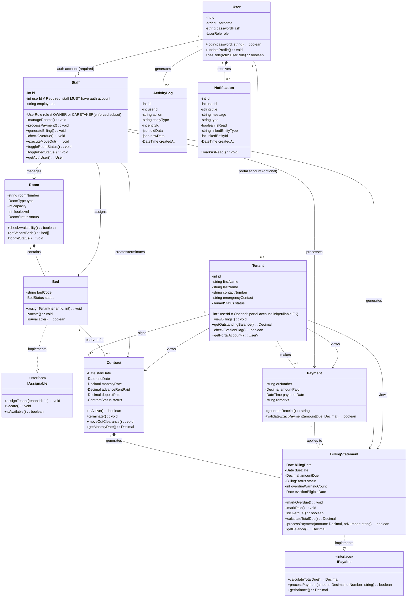

# Conceptual Simplified Class Diagram — RenTahanan

**Purpose:** Pure OOP domain model — classes, composition, interfaces, relationships only  
**Audience:** Developers, architects — shows object structure without data-type noise  
**Alignment:** Matches ERD (live database), implemented backend, and all requirements  

---

## Mermaid Class Diagram

---

## The 8 Pillars of OOP (Applied to RenTahanan)

### Abstraction
Hiding complex reality, exposing only what's necessary. You don't need to know how a car engine works to press the gas pedal. In this diagram, **`User` is the single authentication abstraction**. It holds shared mechanics (`login()`, `updateProfile()`, `hasRole()`) so domain objects don't rewrite auth logic.

### Inheritance
**Not used for User/Tenant/Staff** — this was a deliberate correction. The original design used inheritance (`User <|-- Tenant`), but that misrepresents the domain: a Tenant is not a *type of* User. Instead, we use **Composition**: `User "1" -- "0..1" Tenant` (optional portal account) and `User "1" -- "1" Staff` (required auth account). Tenant and Staff *have* a User for authentication, they don't *inherit* from it.

### Interface
A strict contract — a job description. It promises actions without writing code. **`IPayable`** demands anything claiming to be payable must have `calculateTotalDue()`, `processPayment()`, `getBalance()`. **`IAssignable`** demands rentable units have `assignTenant()`, `vacate()`, `isAvailable()`. This forces consistency across unrelated classes.

### Polymorphism
"Many forms." Treat different objects as the same type if they follow the same interface. Because **`BillingStatement implements IPayable`**, the payment system works with "Payable" things generically. Add a `WaterDamageFine` implementing `IPayable` later — the payment system processes both without knowing the concrete type. **`Bed implements IAssignable`** allows `ContractService` to assign any assignable unit.

### Encapsulation
A protective bubble around data. Fields are **private (`-`)** — outside code cannot directly mess with `Tenant.status` or `BillingStatement.amountDue`. To change billing status to paid, you must call the public `markPaid()` method, which enforces all business logic first. To assign a tenant, you call `Bed.assignTenant()` which checks `isAvailable()` before updating status.

### Composition
Strict "part-of" — if the parent dies, the child dies. 
- **`Room *-- Bed`**: A Room is composed of Beds. If a room is decommissioned, its beds cease to exist. They cannot float independently. (ERD: CASCADE DELETE)
- **`Contract *-- BillingStatement`**: A Contract generates Billings. If a contract is terminated, its billings are deleted (CASCADE). The bills don't survive the contract's death — this matches the ERD's CASCADE rule.
- **`User -- Tenant` (optional)** / **`User -- Staff` (required)**: Authentication *owns* the domain profile. Delete User → profile unlinked (SET NULL for Tenant, cascade for Staff).

### Aggregation
**None in this domain** — all whole-part relationships use Composition (CASCADE in ERD). The original diagram showed `Contract o-- BillingStatement` (Aggregation), but the ERD enforces CASCADE DELETE, making it Composition.

### Association
Two independent objects that know each other. 
- **`Tenant -- Contract`**: Both exist independently, linked to represent a lease agreement. A tenant signs multiple contracts over time.
- **`Bed -- Contract`**: One bed tied to 0..1 active contract at a time (no double-booking).
- **`Tenant -- Payment`**: A tenant makes many payments over their stay.
- **`Payment -- BillingStatement`**: 0..1 because "walk-in" payments may not link to a digital bill yet.

---

## The Classes (Role & Responsibility)

| Class | Role |
|-------|------|
| **User** | Foundational authentication. Holds credentials (`username`, `passwordHash`, `role`) and basic auth (`login()`, `updateProfile()`, `hasRole()`). |
| **Tenant** | Resident profile. Optional `User` link for portal access. Tracks personal details, `status` (`ACTIVE`/`MOVED_OUT`/`FLAGGED_DEBT`), and portal actions (`viewBillings()`, `getOutstandingBalance()`, `checkEvasionFlag()`). |
| **Staff** | Staff profile. Required `User` link (must authenticate). Role = `OWNER` or `CARETAKER`. Daily operations: `manageRooms()`, `processPayment()`, `generateBilling()`, `checkOverdue()`, `executeMoveOut()`, `toggleRoomStatus()`, `toggleBedStatus()`. |
| **IPayable** | Rulebook for payments. Ensures standard handling: `calculateTotalDue()`, `processPayment()`, `getBalance()`. |
| **IAssignable** | Rulebook for rentable units. Ensures standard assignment: `assignTenant()`, `vacate()`, `isAvailable()`. |
| **Room** | Physical container. Tracks capacity, `floorLevel`, `status` (`ACTIVE`/`UNDER_MAINTENANCE`/`DECOMMISSIONED`), manages its specific beds. |
| **Bed** | Actual rentable unit. Tracks status (`VACANT`/`OCCUPIED`/`OVERDUE`/`UNAVAILABLE`), handles assignment via `IAssignable`. |
| **Contract** | Legal glue. Binds `Tenant` to `Bed` for a date range, locks `monthlyRate`, tracks `advanceRentPaid` and `depositPaid`. Handles move-out with `terminate()` (pay-before-leave) and `moveOutClearance()` (deposit reconciliation). |
| **BillingStatement** | Monthly invoice. Tracks owed amount, due date, overdue escalation (`overdueWarningCount`, `evictionEligibleDate`). Implements `IPayable`. |
| **Payment** | Cash handover. Records exact amount, `orNumber` (Official Receipt), validates cash matches bill exactly. |

---

## The Connections (Line-by-Line)

### `User "1" -- "0..1" Tenant` and `User "1" -- "1" Staff`
**Plain solid line = Association (Composition semantics).** `User` *has* optional `Tenant` portal account (nullable FK) and required `Staff` auth account. Not inheritance — composition. Tenant/Staff *delegate* auth to User.

### `BillingStatement ..|> IPayable` and `Bed ..|> IAssignable`
**Dashed line, hollow closed arrow = Realization (Implementation).** The class promises to fulfill the interface methods.

### `Room "1" *-- "1..*" Bed`
**Solid line, filled diamond = Composition.** Exactly **1** Room owns **1..*** Beds. Filled diamond touches `Room` (the owner). Delete Room → Beds destroyed (ERD: CASCADE DELETE).

### `Contract "1" *-- "1..*" BillingStatement`
**Solid line, filled diamond = Composition.** **1** Contract generates **1..*** BillingStatements. Filled diamond touches `Contract`. Contract ends → Billings deleted (ERD: CASCADE DELETE). *This was corrected from Aggregation to match ERD.*

### `Tenant "1" -- "0..*" Contract`
**Plain solid line = Association.** Exactly **1** Tenant signs **0..*** Contracts over time.

### `Bed "1" -- "0..1" Contract`
**Association.** Exactly **1** Bed tied to **0..1** active Contract at a time (no double-booking).

### `Tenant "1" -- "0..*" Payment`
**Association.** Exactly **1** Tenant makes **0..*** Payments over their stay.

### `Payment "1" -- "0..1" BillingStatement`
**Association.** **1** Payment applies to **0..1** BillingStatement. **0..1** because "walk-in" payments may not link to a digital bill yet.

### `Staff --> [Domain Objects]` and `Tenant --> [Domain Objects]`
**Dashed line, open arrow = Dependency / Directed Association.** Shows interaction flow. `Staff` actively manages, creates, processes. `Tenant` mainly views. Illustrates who drives the system.

### `Staff --> User` and `Tenant --> User`
**Dashed line, open arrow = Delegation.** `Staff` and `Tenant` delegate authentication to their linked `User`.

---

## Design Rationale: Why Not Inheritance?

**Previous (Wrong):** `User <|-- Tenant` and `User <|-- Staff`

**Correct (Composition):**
- `User` = **Authentication only** (username, passwordHash, role)
- `Tenant` = **Resident profile** (optional `User` link for portal)
- `Staff` = **Staff profile** (required `User` link, role = OWNER/CARETAKER)

**Why:**
1. **ERD has no `staff` table** — staff are `users` with role OWNER/CARETAKER
2. **`tenants.user_id` is nullable** — walk-in tenants without portal work
3. **RBAC is data-driven** — `User.role` determines capabilities, not class hierarchy
4. **Single auth source** — JWT middleware reads `User.role` for all 3 roles
5. **SRP respected** — `User` changes only for auth; `Tenant`/`Staff` change for domain logic

---

*Pure OOP view — matches ERD, implemented backend, and all requirements. Just objects, interfaces, and the messages they send.*