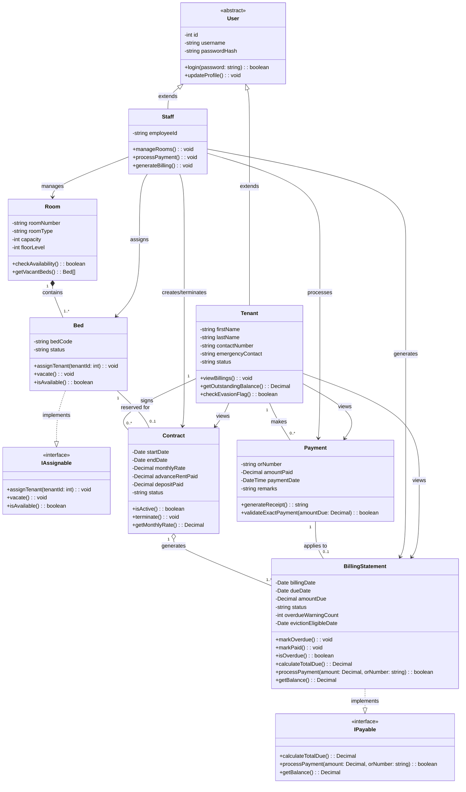

# Conceptual Simplified Class Diagram — RenTahanan

**Purpose:** Pure OOP domain model — classes, inheritance, interfaces, relationships only  
**Audience:** Developers, architects — shows object structure without data-type noise  

---

## Mermaid Class Diagram

---

## OOP Concepts Applied

| Concept | Where | Purpose |
|---------|-------|---------|
| **Abstraction** | `User` (abstract) | Common auth base — cannot instantiate directly |
| **Inheritance** | `Staff`, `Tenant` extend `User` | Share `login()`, `updateProfile()`; specialize behavior |
| **Interface** | `IPayable`, `IAssignable` | Define *what* objects can do, not *how* |
| **Polymorphism** | `BillingStatement` implements `IPayable` | `PaymentService` works with any `IPayable` |
| **Encapsulation** | All fields `private` (`-`) | State changed only via methods |
| **Composition** | `Room *-- Bed` | Room owns Beds — lifecycle bound together |
| **Aggregation** | `Contract o-- BillingStatement` | Contract generates Billings, but Billings can exist independently |
| **Association** | `Tenant -- Contract`, `Bed -- Contract` | Standard object links |

---

## Class Responsibilities (Single Responsibility Principle)

| Class | One Reason to Change |
|-------|---------------------|
| `User` | Authentication mechanics |
| `Staff` | Caretaker/Owner operations |
| `Tenant` | Boarder portal & profile |
| `Room` | Physical room properties |
| `Bed` | Individual bed assignment & status |
| `Contract` | Lease terms & lifecycle |
| `BillingStatement` | Monthly charge & payment state |
| `Payment` | Cash receipt & OR tracking |

---

## Key Business Rules Encapsulated in Methods

| Rule | Method | Enforced By |
|------|--------|-------------|
| **No partial payments** | `Payment.validateExactPayment()` | Throws if `amountPaid !== amountDue` |
| **Exact payment + OR** | `IPayable.processPayment(amount, orNumber)` | Interface contract |
| **Pay before leave** | `Contract.terminate()` | Checks `BillingStatement.getBalance() == 0` |
| **Overdue escalation** | `BillingStatement.markOverdue()` | Increments warnings, sets eviction date |
| **One active contract per bed** | `Bed.assignTenant()` + `IAssignable` | `isAvailable()` check before assign |
| **Evasion blocking** | `Tenant.checkEvasionFlag()` | Returns `true` if `status == FLAGGED_DEBT` with balance |

---

## Why No Enumerations?

Enums (`UserRole`, `RoomType`, `BedStatus`, etc.) are **value types**, not objects. They don't have:
- Identity (no `id`)
- Behavior (no methods)
- Lifecycle (no create/destroy)
- Relationships (no associations)

In pure OOP class diagrams, enums appear as **attribute types** (e.g., `Bed.status: BedStatus`), not as classes. This diagram shows **objects and their collaborations** — the runtime structure.

---

## Quick Reference: Relationship Legend

| Symbol | Name | Meaning |
|--------|------|---------|
| `<|--` | Inheritance | Child *is-a* Parent |
| `..|>` | Realization | Class *implements* Interface |
| `*--` | Composition | Whole owns Parts (lifecycle bound) |
| `o--` | Aggregation | Whole has Parts (independent lifecycle) |
| `--` | Association | Objects know each other |

---

## The 8 Pillars of OOP (Applied to RenTahanan)

### Abstraction
Hiding complex reality, exposing only what's necessary. You don't need to know how a car engine works to press the gas pedal. In this diagram, **`User` is abstract (`<<abstract>>`)**. You never create a raw "User" — you create a specific `Tenant` or `Staff`. `User` holds shared mechanics (`login()`, `updateProfile()`) so subclasses don't rewrite them.

### Inheritance
The "is-a" relationship. A child absorbs all traits and behaviors of its parent. **`Tenant is a User`**, **`Staff is a User`**. Because of inheritance, `Tenant` automatically gets `username`, `passwordHash`, and `login()` from `User`, plus its own specific traits like `emergencyContact`.

### Interface
A strict contract — a job description. It promises actions without writing code. **`IPayable`** demands anything claiming to be payable must have `calculateTotalDue()` and `processPayment()`. It forces consistency across unrelated classes.

### Polymorphism
"Many forms." Treat different objects as the same type if they follow the same interface or inheritance tree. Because **`BillingStatement implements IPayable`**, the system works with "Payable" things generically. Add a `WaterDamageFine` implementing `IPayable` later — the payment system processes both without knowing the concrete type.

### Encapsulation
A protective bubble around data. Fields are **private (`-`)** — outside code cannot directly mess with `Tenant.status` or `BillingStatement.amountDue`. To change billing status to paid, you must call the public `markPaid()` method, which enforces all business logic first.

### Composition
Strict "part-of" — if the parent dies, the child dies. **`Room *-- Bed`**: A Room is composed of Beds. If a room is removed, its beds cease to exist. They cannot float independently.

### Aggregation
Loose "part-of." **`Contract o-- BillingStatement`**: A Contract generates Billings, but if a tenant terminates and moves out, unpaid Billings still exist and must be paid. The bills survive the contract's death.

### Association
Two independent objects that know each other. **`Tenant -- Contract`**: Both exist independently, linked to represent a real-world event.

---

## The Classes (Role & Responsibility)

| Class | Role |
|-------|------|
| **User** | Foundational identity. Holds credentials (`username`, `passwordHash`) and basic authentication (`login()`). |
| **Staff** | Management side. Inherits `User`, adds superpowers: `manageRooms()`, `processPayment()`, `generateBilling()`. |
| **Tenant** | Customer side. Inherits `User`, adds personal details (`contactNumber`, `emergencyContact`) and portal actions: `checkEvasionFlag()`, `viewBillings()`. |
| **IPayable** | Rulebook for payments. Ensures standard handling: `calculateTotalDue()`, `processPayment()`, `getBalance()`. |
| **IAssignable** | Rulebook for rentable units. Ensures standard assignment: `assignTenant()`, `vacate()`, `isAvailable()`. |
| **Room** | Physical container. Tracks capacity, `floorLevel`, manages its specific beds. |
| **Bed** | Actual rentable unit. Tracks status (`VACANT`/`OCCUPIED`/`OVERDUE`), handles assignment. |
| **Contract** | Legal glue. Binds `Tenant` to `Bed` for a date range, locks `monthlyRate`, tracks deposits. |
| **BillingStatement** | Monthly invoice. Tracks owed amount, due date, overdue escalation (`overdueWarningCount`, `evictionEligibleDate`). |
| **Payment** | Cash handover. Records exact amount, `orNumber` (Official Receipt), validates cash matches bill exactly. |

---

## The Connections (Line-by-Line)

### `User <|-- Staff` and `User <|-- Tenant`
**Solid line, hollow closed arrow = Inheritance.** `Staff` and `Tenant` inherit everything from `User`.

### `BillingStatement ..|> IPayable` and `Bed ..|> IAssignable`
**Dashed line, hollow closed arrow = Realization (Implementation).** The class promises to fulfill the interface methods.

### `Room "1" *-- "1..*" Bed`
**Solid line, filled diamond = Composition.** Exactly **1** Room owns **1..*** Beds. Filled diamond touches `Room` (the owner). Delete Room → Beds destroyed.

### `Contract "1" o-- "1..*" BillingStatement`
**Solid line, hollow diamond = Aggregation.** **1** Contract generates **1..*** BillingStatements. Hollow diamond touches `Contract`. Contract ends → Billings persist.

### `Tenant "1" -- "0..*" Contract`
**Plain solid line = Association.** Exactly **1** Tenant signs **0..*** Contracts over time.

### `Bed "1" -- "0..1" Contract`
**Association.** Exactly **1** Bed tied to **0..1** active Contract at a time (no double-booking).

### `Tenant "1" -- "0..*" Payment`
**Association.** Exactly **1** Tenant makes **0..*** Payments over their stay.

### `Payment "1" -- "0..1" BillingStatement`
**Association.** **1** Payment applies to **0..1** BillingStatement. **0..1** because "walk-in" payments may not link to a digital bill yet.

### `Staff --> [Domain Objects]` and `Tenant --> [Domain Objects]`
**Dashed line, open arrow = Dependency / Directed Association.** Shows interaction flow. `Staff` actively manages, creates, processes. `Tenant` mainly views. Illustrates who drives the system.

---

*Pure OOP view — no infrastructure, no persistence, no framework types. Just objects, interfaces, and the messages they send.*