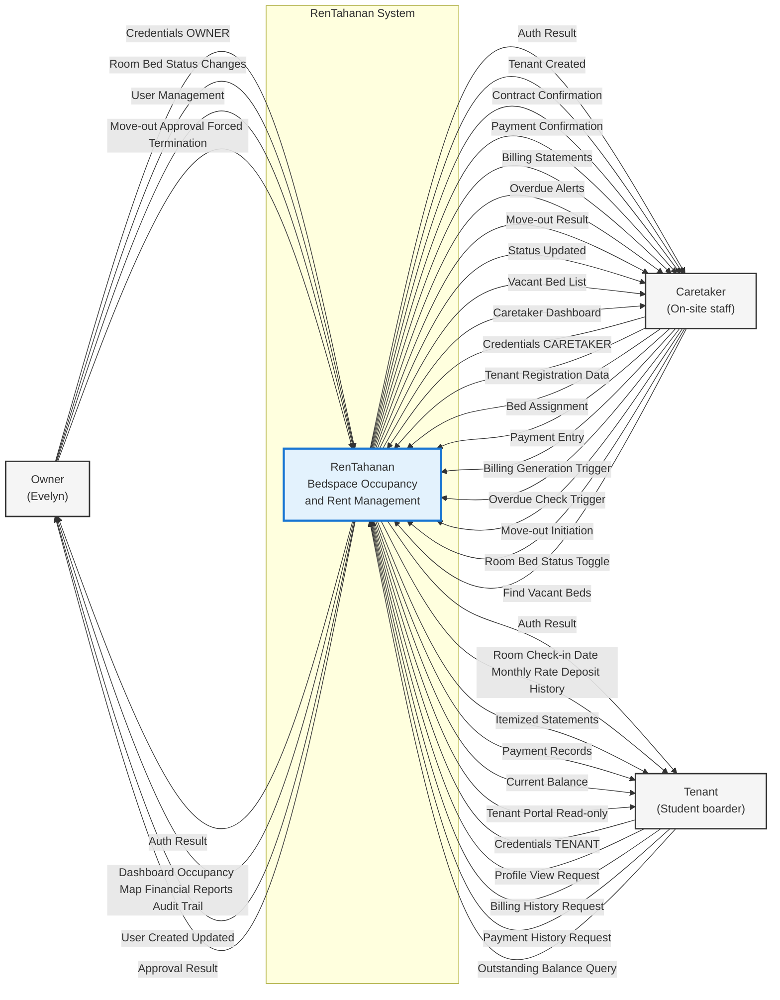
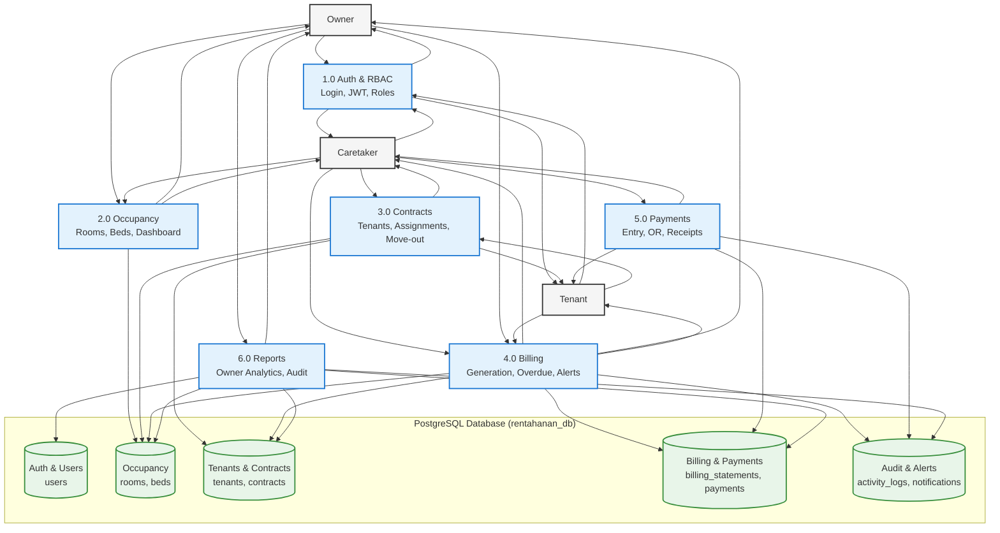
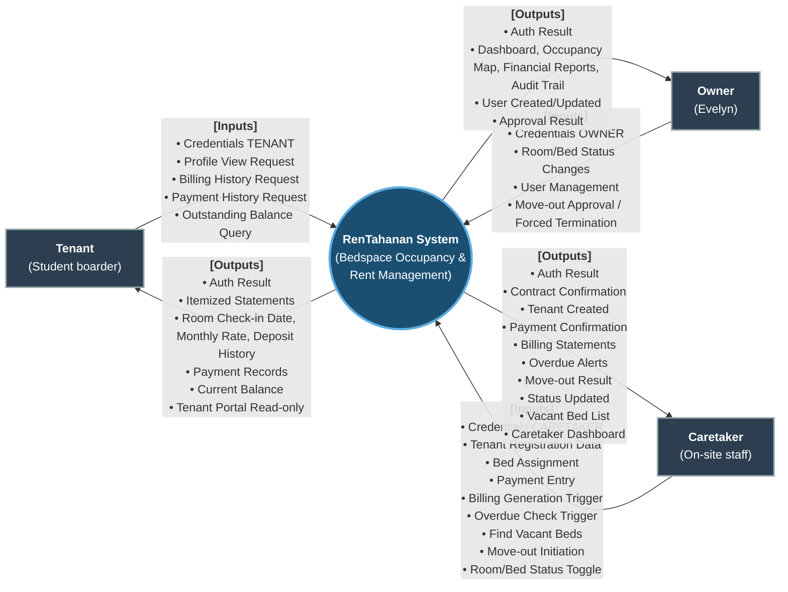

# Data Flow Diagram — RenTahanan

**Generated:** 2026-11-22  
**Format:** Mermaid (renderable in GitHub, VS Code, Notion)  
**Level:** Context Diagram (Level 0) + Level 1 Decomposition  
**Alignment:** Requirements (US-01 to US-12, FR-01 to FR-07) ↔ ERD.md ↔ Implementation Class Diagram ↔ System Architecture  

---

## 1. Context Diagram (Level 0) — System Boundary

*Shows the system as a single black box with only the three external actors. All data flows are detailed per requirements. Database is internal (not an actor).*

---

## 2. Level 1 Diagram — Simplified Process Decomposition

*Decomposes the black box into 6 major processes (aligned to Service Layer in Class Diagram). Simplified view showing only primary processes and data store groups.*

---

## 3. Data Dictionary — Key Data Flows

| Flow ID | Source → Destination | Data Content | Frequency | Trigger |
|---------|---------------------|--------------|-----------|---------|
| DF-01 | Actor → 1.1 | `username`, `password` | Per session | User login |
| DF-02 | 1.1 → Actor | `JWT(token, role, userId)` | Per session | Login success |
| DF-03 | Actor → 3.1 | `firstName`, `lastName`, `contactNumber`, `emergencyContact` | Onboarding | New tenant |
| DF-04 | 3.1 → D4 | `tenant_id`, `user_id?`, `status=ACTIVE` | Onboarding | Profile created |
| DF-05 | Caretaker → 3.2 | `tenantId`, `bedId`, `startDate`, `endDate`, `monthlyRate`, `advanceRentPaid`, `depositPaid` | Per contract | Bed assignment |
| DF-06 | 3.3 → D3 | `SELECT ... FOR UPDATE` (bed row lock) | Per contract | Concurrency control |
| DF-07 | 3.2 → D5 | `contract_id`, `status=ACTIVE`, `advance_rent_paid`, `deposit_paid` | Per contract | Contract created |
| DF-08 | 3.2 → D3 | `bed_id`, `status=OCCUPIED` | Per contract | Bed occupied |
| DF-09 | Caretaker/Owner → 4.1 | `trigger: generate_monthly` | Monthly | Billing cycle |
| DF-10 | 4.1 → D5 | `SELECT * FROM contracts WHERE status='ACTIVE'` | Monthly | Find active |
| DF-11 | 4.2 → D6 | `billing_statement_id`, `contract_id`, `tenant_id`, `amount_due=monthlyRate`, `status=UNPAID`, `due_date` | Monthly × active contracts | Statement created |
| DF-12 | Cron → 4.3 | `trigger: check_overdue` | Weekly | Scheduled job |
| DF-13 | 4.3 → D6 | `UPDATE billing SET status='OVERDUE', warning_count=warning_count+1, eviction_eligible_date=due_date+'3 months'` | Weekly × overdue | Escalation |
| DF-14 | 4.4 → D3 | `UPDATE beds SET status='OVERDUE' WHERE bed_id IN (...)` | Weekly × overdue | Dashboard sync |
| DF-15 | Caretaker → 5.1 | `amountPaid`, `paymentDate`, `orNumber`, `tenantId`, `billingStatementId?`, `signature`, `remarks` | Per payment | Cash collection |
| DF-16 | 5.2 → D7 | `SELECT * FROM payments WHERE or_number = ?` | Per payment | Uniqueness check |
| DF-17 | 5.3 | `amountPaid == amountDue` validation | Per payment | Business rule |
| DF-18 | 5.1 → D7 | `payment_id`, `or_number`, `amount_paid`, `tenant_id`, `logged_by_user_id`, `billing_statement_id?` | Per payment | Payment logged |
| DF-19 | 5.4 → D6 | `UPDATE billing SET status='PAID' WHERE billing_statement_id = ?` | Per full payment | Billing paid |
| DF-20 | Caretaker → 3.5 | `contractId` (move-out initiation) | Per move-out | Tenant leaving |
| DF-21 | 3.5 → D6 | `SELECT SUM(amount_due) FROM billing WHERE tenant_id AND status IN ('UNPAID','OVERDUE')` | Per move-out | Outstanding calc |
| DF-22 | 3.5 → D5 | `SELECT deposit_paid FROM contracts WHERE contract_id = ?` | Per move-out | Deposit read |
| DF-23 | 3.5 → D4 | `UPDATE tenants SET status='MOVED_OUT' OR 'FLAGGED_DEBT'` | Per move-out | Status update |
| DF-24 | 3.5 → D5 | `UPDATE contracts SET status='TERMINATED'` | Per move-out | Contract end |
| DF-25 | 3.5 → D3 | `UPDATE beds SET status='VACANT'` | Per move-out | Bed freed |
| DF-26 | 3.5 → Caretaker | `MoveOutResult {newStatus, depositRefunded, remainingDebt, isFlaggedDebt}` | Per move-out | Result |
| DF-27 | Owner → 6.1-6.4 | `reportType` | On demand | Owner request |
| DF-28 | 6.1 → D2/D3 | Aggregations for occupancy rate | On demand | Report |
| DF-29 | 6.2 → D7/D5/D6 | Financial aggregates (revenue, outstanding, deposits) | On demand | Report |
| DF-30 | 6.3 → D6/D4 | Overdue aging + eviction eligible | On demand | Report |
| DF-31 | 6.4 → D4 | `SELECT * FROM tenants WHERE status='FLAGGED_DEBT'` | On demand | Report |
| DF-32 | 6.5 → D8 | `SELECT * FROM activity_logs ORDER BY created_at DESC` | On demand | Report |
| DF-33 | All sensitive processes → D8 | `action`, `entity_type`, `entity_id`, `old_value`, `new_value`, `user_id` | Per action | Audit trail |

---

## 4. Process-to-Requirement Traceability

| Process | User Stories | Functional Requirements | Non-Functional |
|---------|-------------|------------------------|----------------|
| **1.0 Auth & AuthZ** | US-10 | FR-06.4, FR-06.5 | NFR-06, NFR-08 |
| **2.0 Occupancy** | US-01, US-02 | FR-01.1, FR-01.2, FR-01.3, FR-01.4, FR-01.5 | NFR-01, NFR-02, NFR-04 |
| **3.0 Tenant & Contract** | US-02, US-03, US-09, US-12 | FR-01.6, FR-01.7, FR-01.8, FR-05.1–5.6, FR-06.6, FR-07.1–7.4 | NFR-09, NFR-10, NFR-11 |
| **4.0 Billing** | US-04, US-05, US-07 | FR-02.1–2.5, FR-04.1–4.5 | NFR-04, NFR-11 |
| **5.0 Payments** | US-06, US-08, US-11 | FR-03.1–3.7 | NFR-03, NFR-05, NFR-07, NFR-13 |
| **6.0 Reports** | US-01, US-07, US-12 | FR-06.1, FR-07.1–7.4 | NFR-04, NFR-13 |

---

## 5. Critical Data Flow Invariants (Enforced at DB + API)

| Invariant | Enforcement Point | Data Flow Ref |
|-----------|-------------------|---------------|
| **OR Number Uniqueness** | DB UNIQUE + 5.2 API check | DF-16 |
| **Exact Payment Only** | 5.3 Service validation | DF-17 |
| **No Double-Booking** | 3.3 `FOR UPDATE` + RESTRICT FK | DF-06, DF-07 |
| **One Active Contract/Tenant** | 3.3 Query + RESTRICT FK | DF-07 |
| **One Active Contract/Bed** | 3.3 Query + RESTRICT FK | DF-07 |
| **Pay-Before-Leave** | 3.4 Query unpaid billings | DF-20 (block) |
| **Deposit Reconciliation** | 3.5 Transactional calculation | DF-21 to DF-25 |
| **FLAGGED_DEBT Only on Move-Out** | 3.5 Logic (not during tenancy) | DF-23 |
| **Bed Status = OVERDUE ↔ Billing OVERDUE** | 4.3 + 4.4 Transactional | DF-13, DF-14 |
| **Room/Bed Never Deleted by Users** | No DELETE endpoints; Status only | DF-05 (2.1, 2.2) |
| **Tenant Never Deleted** | No DELETE endpoint; Status only | DF-04 (3.1) |
| **Audit Trail on All Sensitive Actions** | 1.4, 2.1, 2.2, 3.2, 3.4, 3.5, 3.6, 4.1, 4.3, 5.1 | DF-33 |

---

## 6. Alignment Verification

| Artifact | Status | Notes |
|----------|--------|-------|
| `docs/REQUIREMENTS.md` (12 US, 37 FR, 15 NFR) | ✅ 100% Traced | Every process maps to US/FR/NFR |
| `docs/diagrams/ERD.md` (7 tables, 7 enums, 9 FKs) | ✅ 100% Mapped | All data stores D1–D9 match ERD tables |
| `docs/diagrams/IMPLEMENTATION_CLASS_DIAGRAM.md` | ✅ 100% Mapped | Processes map to Services + Controllers |
| `docs/diagrams/CONCEPTUAL_SIMPLIFIED_DIAGRAM.md` | ✅ 100% Mapped | Domain entities match data stores |
| `docs/diagrams/SYSTEM_ARCHITECTURE.md` | ✅ 100% Consistent | Level 1 processes = Service layer methods |

---

---

## Appendix: Simplified Context Diagram (Level 0) — Standard DFD Notation

*Same data flows as the detailed Context Diagram above, presented in standard DFD notation (circle = process, rectangles = external entities) with grouped inputs/outputs for readability. Uses HTML labels for formatting — renders in GitHub, VS Code, Mermaid Live Editor.*

---

*Generated from requirements, ERD, class diagrams, and system architecture. This Data Flow Diagram shows **Context (Level 0)** system boundary with all three external actors and detailed unidirectional flows, and **Level 1** decomposition into 6 major processes with grouped data store interactions, aligned with the RenTahanan PostgreSQL schema and PERN backend implementation.*