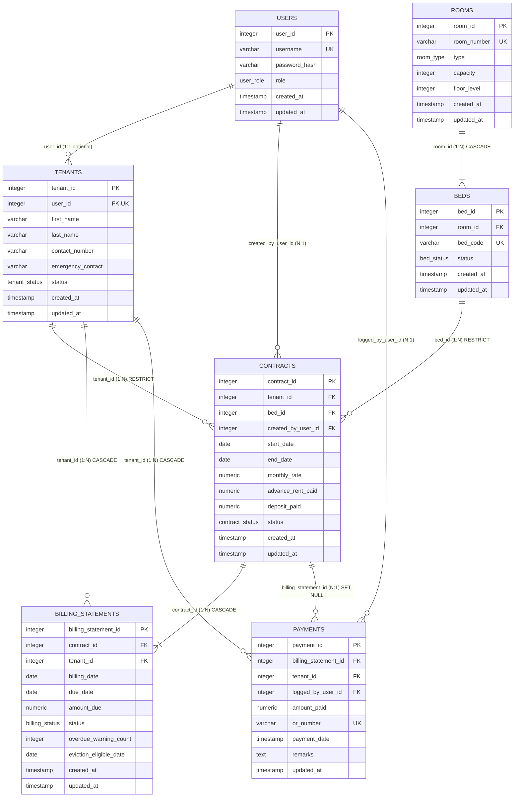
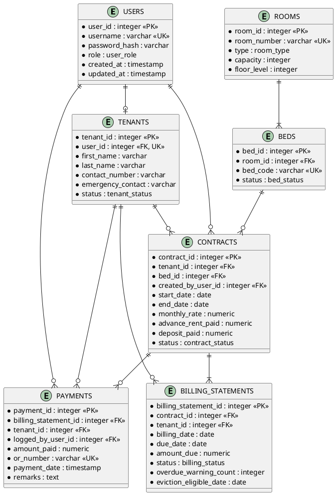

# Entity Relationship Diagram (ERD) — RenTahanan

**Database:** `rentahanan_db`  
**Generated:** 2026-11-20  
**Source:** Live database analysis + `server/schema/init.sql`

---

## ERD (Mermaid)



---

## Table Summary

| Table | Rows (est.) | Purpose |
|-------|-------------|---------|
| `users` | ~3 | Authentication & roles |
| `rooms` | ~10-50 | Physical room definitions |
| `beds` | ~50-200 | Individual bedspaces |
| `tenants` | ~50-200 | Resident profiles |
| `contracts` | ~50-200 | Lease agreements |
| `billing_statements` | ~600-2400/yr | Monthly rent bills |
| `payments` | ~600-2400/yr | Cash collections + OR |

---

## Key Relationships

### 1. Room → Bed (1:N, CASCADE)
- Room deleted → Beds deleted
- Bed knows its room via `room_id`

### 2. Tenant ↔ Contract (1:N, RESTRICT)
- One tenant → multiple contracts over time
- **Only ONE active contract per tenant** (enforced at API level)
- Tenant cannot be deleted if active contract exists

### 3. Bed ↔ Contract (1:N, RESTRICT)
- One bed → multiple contracts over time
- **Only ONE active contract per bed** (enforced via `FOR UPDATE` lock)
- Bed cannot be deleted if active contract exists

### 4. Contract → Billing (1:N, CASCADE)
- Contract deleted → Billings deleted
- Billing knows its contract + tenant

### 5. Billing ↔ Payment (1:N, SET NULL)
- Payment can exist without billing (walk-in)
- Payment can link to billing statement
- Full payment (`amount_paid == amount_due`) → Billing = `PAID`

### 6. User → Tenant (1:1 optional, SET NULL)
- User deleted → Tenant profile preserved
- Tenant can have portal access via `user_id`

### 7. User → Contract/Payment (N:1, SET NULL)
- Staff who created contract / logged payment
- User deleted → Contract/Payment preserved, link cleared

---

## ENUM Definitions

| Enum | Values | Used In |
|------|--------|---------|
| `user_role` | `OWNER`, `CARETAKER`, `TENANT` | `users.role` |
| `room_type` | `SINGLE`, `DOUBLE`, `QUAD` | `rooms.type` |
| `bed_status` | `VACANT`, `OCCUPIED`, `OVERDUE` | `beds.status` |
| `tenant_status` | `ACTIVE`, `MOVED_OUT`, `FLAGGED_DEBT` | `tenants.status` |
| `contract_status` | `ACTIVE`, `COMPLETED`, `TERMINATED` | `contracts.status` |
| `billing_status` | `UNPAID`, `PAID`, `OVERDUE` | `billing_statements.status` |

---

## Critical Constraints

| Constraint | Tables | Purpose |
|------------|--------|---------|
| `beds.bed_code` UNIQUE | `beds` | Unique bed identifier (e.g., `R101-A`) |
| `rooms.room_number` UNIQUE | `rooms` | Unique room label |
| `payments.or_number` UNIQUE | `payments` | Official Receipt uniqueness |
| `tenants.user_id` UNIQUE | `tenants` | One tenant profile per user |
| `contracts.bed_id` RESTRICT | `contracts` → `beds` | Prevent bed deletion with active contract |
| `contracts.tenant_id` RESTRICT | `contracts` → `tenants` | Prevent tenant deletion with active contract |
| `beds.status` CHECK (enum) | `beds` | Valid status only |
| `payments.amount_paid > 0` CHECK | `payments` | Positive amounts only |

---

## Trigger: `updated_at` Auto-Update

All 7 tables have:
```sql
CREATE TRIGGER update_<table>_updated_at
    BEFORE UPDATE ON <table>
    FOR EACH ROW EXECUTE FUNCTION update_updated_at_column();
```

Function:
```sql
CREATE OR REPLACE FUNCTION update_updated_at_column()
RETURNS TRIGGER AS $$
BEGIN
    NEW.updated_at = CURRENT_TIMESTAMP;
    RETURN NEW;
END;
$$ language 'plpgsql';
```

---

## Indexes

| Index | Table | Columns | Purpose |
|-------|-------|---------|---------|
| `idx_beds_status` | `beds` | `status` | Fast vacant/occupied lookup |
| `idx_billing_status` | `billing_statements` | `status` | Overdue/unpaid filtering |
| `idx_payments_or` | `payments` | `or_number` | OR number lookup |
| `idx_contracts_tenant` | `contracts` | `tenant_id` | Tenant contract history |
| *PK indexes* | All tables | `<table>_id` | Primary key lookups |
| *UK indexes* | Various | Unique columns | Uniqueness enforcement |

---

## Business Rules Enforced at DB Level

1. **Unique OR numbers** — `payments.or_number` UNIQUE
2. **No double-booking** — `contracts.bed_id` RESTRICT + API `FOR UPDATE` lock
3. **One active contract per bed** — `beds.status` + API validation
4. **No partial payments** — API validates `amount_paid == amount_due` (exact full payment only)
5. **Cascade cleanup** — Room delete → Beds deleted; Contract delete → Billings deleted
6. **Audit trail** — `created_by_user_id`, `logged_by_user_id`, `updated_at` triggers

---

## Visual Reference (PlantUML Alternative)



---

## Verification Checklist

- [x] All 7 tables exist with correct columns
- [x] All 6 ENUMs defined and used
- [x] All 10 FKs with correct delete rules
- [x] 7 triggers for `updated_at` auto-update
- [x] 15 indexes (PK, UK, custom)
- [x] All CHECK constraints in place
- [x] Seed data present (2 users, 50 rooms across 2 floors, ~50+ beds)
- [x] Connection pool working (`pg.Pool`)

---

*Generated from live database `rentahanan_db` on 2026-11-18*