# Class Diagram — RenTahanan

**Generated:** 2026-11-21  
**Purpose:** Object-oriented structure reflecting the implemented PERN backend, aligned with requirements (US, FR, NFR, AC)  
**Status:** Updated — reflects requirements clarification (move-out logic, RBAC, room/bed status enums)

---

## Mermaid Class Diagram

```mermaid
classDiagram
    %% ==================== ENUMERATIONS ====================
    class UserRole {
        <<enumeration>>
        OWNER
        CARETAKER
        TENANT
    }

    class RoomType {
        <<enumeration>>
        SINGLE
        DOUBLE
        QUAD
    }

    class RoomStatus {
        <<enumeration>>
        ACTIVE
        UNDER_MAINTENANCE
        DECOMMISSIONED
    }

    class BedStatus {
        <<enumeration>>
        VACANT
        OCCUPIED
        OVERDUE
        UNAVAILABLE
    }

    class TenantStatus {
        <<enumeration>>
        ACTIVE
        MOVED_OUT
        FLAGGED_DEBT
    }

    class ContractStatus {
        <<enumeration>>
        ACTIVE
        COMPLETED
        TERMINATED
    }

    class BillingStatus {
        <<enumeration>>
        UNPAID
        PAID
        OVERDUE
    }

    %% ==================== DOMAIN ENTITIES ====================
    class User {
        +int userId
        +string username
        +string passwordHash
        +UserRole role
        +DateTime createdAt
        +DateTime updatedAt
        +verifyPassword(password: string): Promise~boolean~
    }

    class Room {
        +int roomId
        +string roomNumber
        +RoomType type
        +int capacity
        +int floorLevel
        +RoomStatus status
        +DateTime createdAt
        +DateTime updatedAt
        +beds: Bed[]
    }

    class Bed {
        +int bedId
        +int roomId
        +string bedCode
        +BedStatus status
        +DateTime createdAt
        +DateTime updatedAt
        +room: Room
        +activeContract: Contract?
    }

    class Tenant {
        +int tenantId
        +int? userId
        +string firstName
        +string lastName
        +string contactNumber
        +string emergencyContact
        +TenantStatus status
        +DateTime createdAt
        +DateTime updatedAt
        +user: User?
        +contracts: Contract[]
        +billings: BillingStatement[]
        +payments: Payment[]
        +getOutstandingBalance(): Decimal
    }

    class Contract {
        +int contractId
        +int tenantId
        +int bedId
        +int? createdByUserId
        +Date startDate
        +Date endDate
        +Decimal monthlyRate
        +Decimal advanceRentPaid
        +Decimal depositPaid
        +ContractStatus status
        +DateTime createdAt
        +DateTime updatedAt
        +tenant: Tenant
        +bed: Bed
        +createdBy: User?
        +billings: BillingStatement[]
        +isActive(): boolean
        +terminate(): void
    }

    class BillingStatement {
        +int billingStatementId
        +int contractId
        +int tenantId
        +Date billingDate
        +Date dueDate
        +Decimal amountDue
        +BillingStatus status
        +int overdueWarningCount
        +Date? evictionEligibleDate
        +DateTime createdAt
        +DateTime updatedAt
        +contract: Contract
        +tenant: Tenant
        +payments: Payment[]
        +markOverdue(): void
        +markPaid(): void
        +isOverdue(): boolean
        +calculateOutstanding(): Decimal
    }

    class Payment {
        +int paymentId
        +int? billingStatementId
        +int tenantId
        +int loggedByUserId
        +Decimal amountPaid
        +string orNumber
        +DateTime paymentDate
        +string? remarks
        +DateTime updatedAt
        +billingStatement: BillingStatement?
        +tenant: Tenant
        +loggedBy: User
        +validateExactPayment(amountDue: Decimal): void
    }

    %% ==================== REPOSITORIES (Data Access Layer) ====================
    class IRepository~T~ {
        <<interface>>
        +findById(id: int): Promise~T?~
        +findAll(): Promise~T[]~
        +save(entity: T): Promise~T~
        +delete(id: int): Promise~void~
    }

    class UserRepository {
        +findByUsername(username: string): Promise~User?~
        +findByRole(role: UserRole): Promise~User[]~
    }

    class RoomRepository {
        +findByFloor(floor: int): Promise~Room[]~
        +findWithBeds(): Promise~Room[]~
    }

    class BedRepository {
        +findByStatus(status: BedStatus): Promise~Bed[]~
        +findVacantByRoomType(type: RoomType): Promise~Bed[]~
        +lockForUpdate(bedId: int): Promise~Bed?~
    }

    class TenantRepository {
        +findActive(): Promise~Tenant[]~
        +findWithOutstandingBalance(): Promise~Tenant[]~
        +findByUserId(userId: int): Promise~Tenant?~
    }

    class ContractRepository {
        +findActiveByTenant(tenantId: int): Promise~Contract?~
        +findActiveByBed(bedId: int): Promise~Contract?~
        +findExpiringSoon(days: int): Promise~Contract[]~
    }

    class BillingRepository {
        +findUnpaidByTenant(tenantId: int): Promise~BillingStatement[]~
        +findOverdue(): Promise~BillingStatement[]~
        +findByContract(contractId: int): Promise~BillingStatement[]~
    }

    class PaymentRepository {
        +findByOrNumber(orNumber: string): Promise~Payment?~
        +findByTenant(tenantId: int): Promise~Payment[]~
        +findByBillingStatement(billingId: int): Promise~Payment[]~
    }

    %% ==================== SERVICES (Business Logic Layer) ====================
    class AuthService {
        +register(dto: RegisterDTO): Promise~User~
        +login(dto: LoginDTO): Promise~AuthResult~
        +hashPassword(password: string): Promise~string~
        +verifyToken(token: string): Promise~TokenPayload?~
    }

    class RoomService {
        +createRoom(dto: CreateRoomDTO): Promise~Room~
        +updateRoom(id: int, dto: UpdateRoomDTO): Promise~Room~
        +getAllRooms(): Promise~Room[]~
        +getRoomsByFloor(floor: int): Promise~Room[]~
        +updateRoomStatus(roomId: int, status: RoomStatus): Promise~Room~
    }

    class BedService {
        +addBedToRoom(roomId: int, bedCode: string): Promise~Bed~
        +updateBedStatus(bedId: int, status: BedStatus): Promise~Bed~
        +getVacantBeds(): Promise~Bed[]~
        +getBedsByRoom(roomId: int): Promise~Bed[]~
    }

    class TenantService {
        +createTenant(dto: CreateTenantDTO): Promise~Tenant~
        +updateTenant(id: int, dto: UpdateTenantDTO): Promise~Tenant~
        +getTenantProfile(id: int): Promise~TenantProfileDTO~
        +getOutstandingBalance(tenantId: int): Promise~Decimal~
        +checkEvasionFlag(tenantId: int): Promise~boolean~
    }

    class ContractService {
        +createContract(dto: CreateContractDTO): Promise~Contract~
        +terminateContract(contractId: int): Promise~void~
        +moveOutClearance(contractId: int): Promise~MoveOutResult~
        +forceTerminate(contractId: int): Promise~MoveOutResult~
        +checkPayBeforeLeave(tenantId: int): Promise~boolean~
        +getActiveContract(tenantId: int): Promise~Contract?~
        +getContractHistory(tenantId: int): Promise~Contract[]~
    }

    class ReportService {
        +getOccupancyReport(): Promise~OccupancyReportDTO~
        +getFinancialReport(): Promise~FinancialReportDTO~
        +getOverdueAgingReport(): Promise~AgingReportDTO~
        +getEvasionList(): Promise~Tenant[]~
    }

    class BillingService {
        +generateBilling(dto: CreateBillingDTO): Promise~BillingStatement~
        +checkOverdue(): Promise~OverdueCheckResult~
        +getTenantBillings(tenantId: int): Promise~BillingStatement[]~
        +calculateAmountDue(contract: Contract): Decimal
    }

    class PaymentService {
        +recordPayment(dto: CreatePaymentDTO): Promise~Payment~
        +validateExactPayment(amountPaid: Decimal, amountDue: Decimal): void
        +verifyOrUnique(orNumber: string): Promise~boolean~
        +generateReceipt(paymentId: int): Promise~ReceiptDTO~
    }

    %% ==================== DTOs / VALUE OBJECTS ====================
    class RegisterDTO {
        +string username
        +string password
        +UserRole role
    }

    class LoginDTO {
        +string username
        +string password
    }

    class AuthResult {
        +string token
        +User user
    }

    class TokenPayload {
        +int userId
        +string username
        +UserRole role
    }

    class CreateRoomDTO {
        +string roomNumber
        +RoomType type
        +int capacity
        +int floorLevel
    }

    class UpdateRoomDTO {
        +string? roomNumber
        +RoomType? type
        +int? capacity
        +int? floorLevel
    }

    class CreateTenantDTO {
        +int? userId
        +string firstName
        +string lastName
        +string contactNumber
        +string emergencyContact
        +TenantStatus? status
    }

    class UpdateTenantDTO {
        +int? userId
        +string? firstName
        +string? lastName
        +string? contactNumber
        +string? emergencyContact
        +TenantStatus? status
    }

    class CreateContractDTO {
        +int tenantId
        +int bedId
        +Date startDate
        +Date endDate
        +Decimal monthlyRate
        +Decimal advanceRentPaid
        +Decimal depositPaid
    }

    class CreateBillingDTO {
        +int contractId
        +Date dueDate
        +Decimal amountDue
    }

    class CreatePaymentDTO {
        +int? billingStatementId
        +int tenantId
        +Decimal amountPaid
        +string orNumber
        +string? remarks
    }

    class OverdueCheckResult {
        +int updatedCount
        +BillingStatement[] updated
    }

    class TenantProfileDTO {
        +Tenant tenant
        +Contract? activeContract
        +BillingStatement[] billings
        +Decimal outstandingBalance
    }

    class ReceiptDTO {
        +string orNumber
        +Decimal amountPaid
        +Decimal remainingBalance
        +DateTime paymentDate
        +string tenantName
        +string? signature
    }

    class MoveOutResult {
        +TenantStatus newStatus
        +Decimal depositRefunded
        +Decimal remainingDebt
        +boolean isFlaggedDebt
    }

    class OccupancyReportDTO {
        +int totalRooms
        +int totalBeds
        +int occupiedBeds
        +int vacantBeds
        +int overdueBeds
        +int unavailableBeds
        +Decimal occupancyRate
    }

    class FinancialReportDTO {
        +Decimal totalRevenue
        +Decimal outstandingBalance
        +Decimal collectedThisMonth
        +Decimal depositHeld
    }

    class AgingReportDTO {
        +int overdueCount
        +Decimal totalOverdue
        +Tenant[] evictionEligible
    }

    %% ==================== CONTROLLERS (HTTP Layer) ====================
    class BaseController {
        <<abstract>>
        +handleRequest(req, res, next): Promise~void~
    }

    class UserController {
        +register(req, res): Promise~void~
        +login(req, res): Promise~void~
        +getProfile(req, res): Promise~void~
    }

    class RoomController {
        +getAllRooms(req, res): Promise~void~
        +getRoomById(req, res): Promise~void~
        +createRoom(req, res): Promise~void~
        +updateRoom(req, res): Promise~void~
        +updateRoomStatus(req, res): Promise~void~
        %% deleteRoom removed per FR-06.7 (developer migration only)
    }

    class BedController {
        +getAllBeds(req, res): Promise~void~
        +getBedById(req, res): Promise~void~
        +createBed(req, res): Promise~void~
        +updateBed(req, res): Promise~void~
        +updateBedStatus(req, res): Promise~void~
        %% deleteBed removed per FR-06.7 (developer migration only)
    }

    class TenantController {
        +getAllTenants(req, res): Promise~void~
        +getTenantById(req, res): Promise~void~
        +createTenant(req, res): Promise~void~
        +updateTenant(req, res): Promise~void~
        %% deleteTenant removed per FR-06.6 (never deleted, status-only lifecycle)
    }

    class ReportController {
        +getOccupancyReport(req, res): Promise~void~
        +getFinancialReport(req, res): Promise~void~
        +getOverdueAgingReport(req, res): Promise~void~
        +getEvasionList(req, res): Promise~void~
    }

    class ContractController {
        +getAllContracts(req, res): Promise~void~
        +createContract(req, res): Promise~void~
        +terminateContract(req, res): Promise~void~
    }

    class BillingController {
        +getAllBilling(req, res): Promise~void~
        +createBilling(req, res): Promise~void~
        +checkOverdue(req, res): Promise~void~
    }

    class PaymentController {
        +getAllPayments(req, res): Promise~void~
        +createPayment(req, res): Promise~void~
    }

    %% ==================== MIDDLEWARE ====================
    class AuthMiddleware {
        +auth(roles?: UserRole[]): RequestHandler
        +verifyToken(token: string): TokenPayload?
    }

    class ValidationMiddleware {
        +validate(schema: ZodSchema): RequestHandler
    }

    class ErrorHandlerMiddleware {
        +handle(err, req, res, next): void
    }

    %% ==================== RELATIONSHIPS ====================
    User "1" --> "0..1" Tenant : userId
    Room "1" --> "*" Bed : roomId
    Bed "1" --> "0..1" Contract : activeContract
    Tenant "1" --> "*" Contract : tenantId
    Tenant "1" --> "*" BillingStatement : tenantId
    Tenant "1" --> "*" Payment : tenantId
    Contract "1" --> "*" BillingStatement : contractId
    Contract "1" --> "1" Bed : bedId
    Contract "1" --> "1" Tenant : tenantId
    Contract "1" --> "0..1" User : createdByUserId
    BillingStatement "1" --> "*" Payment : billingStatementId
    BillingStatement "1" --> "1" Contract : contractId
    BillingStatement "1" --> "1" Tenant : tenantId
    Payment "1" --> "0..1" BillingStatement : billingStatementId
    Payment "1" --> "1" Tenant : tenantId
    Payment "1" --> "1" User : loggedByUserId

    %% Repository implementations
    UserRepository ..|> IRepository~User~
    RoomRepository ..|> IRepository~Room~
    BedRepository ..|> IRepository~Bed~
    TenantRepository ..|> IRepository~Tenant~
    ContractRepository ..|> IRepository~Contract~
    BillingRepository ..|> IRepository~BillingStatement~
    PaymentRepository ..|> IRepository~Payment~

    %% Services use Repositories
    AuthService --> UserRepository
    RoomService --> RoomRepository
    BedService --> BedRepository
    TenantService --> TenantRepository
    ContractService --> ContractRepository
    ContractService --> BillingRepository
    ContractService --> BedRepository
    BillingService --> BillingRepository
    BillingService --> BedRepository
    PaymentService --> PaymentRepository
    PaymentService --> BillingRepository
    PaymentService --> UserRepository
    ReportService --> RoomRepository
    ReportService --> BedRepository
    ReportService --> TenantRepository
    ReportService --> ContractRepository
    ReportService --> BillingRepository
    ReportService --> PaymentRepository

    %% Controllers use Services
    UserController --> AuthService
    RoomController --> RoomService
    BedController --> BedService
    TenantController --> TenantService
    ContractController --> ContractService
    BillingController --> BillingService
    PaymentController --> PaymentService

    %% Middleware
    AuthMiddleware --> AuthService
```



---

## Architecture Layers

| Layer | Classes | Responsibility |
|-------|---------|----------------|
| **Domain** | `User`, `Room`, `Bed`, `Tenant`, `Contract`, `BillingStatement`, `Payment` | Pure business entities, enums, value objects — no framework dependencies |
| **Repository** | `IRepository<T>`, concrete repositories | Data access, SQL queries, transactions, `FOR UPDATE` locking |
| **Service** | `AuthService`, `RoomService`, `BedService`, `TenantService`, `ContractService`, `BillingService`, `PaymentService` | Business rules, orchestration, validation, cross-entity logic |
| **Controller** | `UserController`, `RoomController`, `BedController`, `TenantController`, `ContractController`, `BillingController`, `PaymentController` | Thin HTTP adapters — map requests to services, handle responses |
| **Middleware** | `AuthMiddleware`, `ValidationMiddleware`, `ErrorHandlerMiddleware` | Cross-cutting concerns: auth, validation, error handling |
| **DTO** | `*DTO`, `*Result` | Request/response shapes, serialization boundaries |

---

## Class Explanations

### Enumerations (Type-Safe Domain Values)

| Enum | Purpose | Used By |
|------|---------|---------|
| **UserRole** | RBAC: `OWNER` (full access), `CARETAKER` (cash/OR only), `TENANT` (read-only portal) | `User`, `AuthMiddleware` |
| **RoomType** | Physical capacity: `SINGLE` (1), `DOUBLE` (2), `QUAD` (4) | `Room`, `CreateRoomDTO` |
| **RoomStatus** | Room lifecycle: `ACTIVE` → `UNDER_MAINTENANCE`/`DECOMMISSIONED` (FR-06.6) | `Room`, `RoomService.updateRoomStatus()` |
| **BedStatus** | Real-time occupancy: `VACANT` → `OCCUPIED` on contract → `OVERDUE` on billing flag → `UNAVAILABLE` (maintenance, FR-06.7) | `Bed`, `BillingService.checkOverdue()`, `BedService.updateBedStatus()` |
| **TenantStatus** | Lifecycle: `ACTIVE` → `MOVED_OUT` on clearance → `FLAGGED_DEBT` on evasion | `Tenant`, `ContractService.moveOutClearance()` |
| **ContractStatus** | Lease state: `ACTIVE` → `TERMINATED`/`COMPLETED` | `Contract`, `ContractService` |
| **BillingStatus** | Payment state: `UNPAID` → `PAID` (exact match) or `OVERDUE` (weekly check) | `BillingStatement`, `PaymentService` |

### Domain Entities (Core Business Objects)

**User** — Authentication principal. Maps to `users` table. One optional `Tenant` profile (for portal access). Roles enforced via JWT claims.

**Room** — Physical room aggregate root. Owns `Bed[]` (cascade delete). Type determines capacity. Status (`ACTIVE`/`UNDER_MAINTENANCE`/`DECOMMISSIONED`) tracks room availability for maintenance (FR-06.6). 50 rooms across 2 floors in seed data.

**Bed** — Individual rentable unit. Status drives dashboard color coding (Green=OCCUPIED, Blue=VACANT, Red=OVERDUE, Gray=UNAVAILABLE). `UNAVAILABLE` for maintenance beds (FR-06.7). `lockForUpdate()` prevents double-booking via `SELECT FOR UPDATE`.

**Tenant** — Resident profile. Links to `User` for portal login. Tracks `status` for evasion flagging (`FLAGGED_DEBT`). Aggregates `outstandingBalance` across all billings.

**Contract** — Lease agreement binding `Tenant` + `Bed`. Transactional create: locks bed, validates no active contract for tenant/bed, sets bed `OCCUPIED`. Stores `monthlyRate`, `advanceRentPaid` (1 month), `depositPaid` (1 month). Terminate enforces **pay-before-leave** (no `UNPAID`/`OVERDUE` billings). `moveOutClearance()` handles deposit reconciliation: calculates outstanding balance, applies deposit, refunds excess (→ `MOVED_OUT`), records shortfall (→ `FLAGGED_DEBT`). `forceTerminate()` for eviction override.

**BillingStatement** — Monthly fixed-rate charge. Bundled utilities included (no submeter math). Tracks `overdueWarningCount` (weekly increment) and `evictionEligibleDate` (due + 3 months). Status flows: `UNPAID` → `PAID` (exact payment) or `OVERDUE` (weekly cron).

**Payment** — Cash collection with **OR number** (unique). `amountPaid` must equal `amountDue` exactly (no partial, no overpay). Walk-in allowed (`billingStatementId` nullable). Logs `loggedByUserId` for audit trail.

---

### Repositories (Data Access — Implements `IRepository<T>`)

| Repository | Key Methods | Business Rules Enforced |
|------------|-------------|------------------------|
| **UserRepository** | `findByUsername`, `findByRole` | Username uniqueness |
| **RoomRepository** | `findByFloor`, `findWithBeds`, `findByStatus` | Room number uniqueness, status filtering |
| **BedRepository** | `findByStatus`, `findVacantByRoomType`, `lockForUpdate` | `FOR UPDATE` row locking for concurrency |
| **TenantRepository** | `findActive`, `findWithOutstandingBalance`, `findByUserId` | Status filtering, evasion check |
| **ContractRepository** | `findActiveByTenant`, `findActiveByBed`, `findExpiringSoon` | One active contract per tenant/bed |
| **BillingRepository** | `findUnpaidByTenant`, `findOverdue`, `findByContract` | Overdue detection, tenant balance |
| **PaymentRepository** | `findByOrNumber`, `findByTenant`, `findByBillingStatement` | OR number uniqueness, audit trail |

---

### Services (Business Logic — Stateless, Transactional)

| Service | Core Responsibilities | Key Methods |
|---------|----------------------|-------------|
| **AuthService** | JWT auth, bcrypt hashing, role claims | `register`, `login`, `verifyToken` |
| **RoomService** | CRUD + floor queries + **status management** | `createRoom`, `getRoomsByFloor`, `updateRoomStatus` |
| **BedService** | Status transitions, vacancy queries | `updateBedStatus`, `getVacantBeds` |
| **TenantService** | Profile CRUD, balance calc, evasion check | `getOutstandingBalance`, `checkEvasionFlag` |
| **ContractService** | **Transactional** create/terminate/move-out, pay-before-leave, deposit reconciliation | `createContract`, `terminateContract`, `moveOutClearance`, `forceTerminate`, `checkPayBeforeLeave` |
| **BillingService** | Monthly generation, **weekly overdue check**, amount calc | `generateBilling`, `checkOverdue`, `calculateAmountDue` |
| **PaymentService** | **Exact payment validation**, OR uniqueness, receipt | `recordPayment`, `validateExactPayment`, `verifyOrUnique`, `generateReceipt` |
| **ReportService** | Audit reports for OWNER (FR-06.1) | `getOccupancyReport`, `getFinancialReport`, `getOverdueAgingReport`, `getEvasionList` |

---

### DTOs (Serialization Boundaries)

- **Request DTOs**: `CreateRoomDTO`, `CreateTenantDTO`, `CreateContractDTO`, `CreateBillingDTO`, `CreatePaymentDTO` — validated via Zod at route level
- **Response DTOs**: `AuthResult`, `TenantProfileDTO`, `OverdueCheckResult`, `ReceiptDTO` — shaped for frontend consumption
- **Value Objects** (recommended): `Money` (Decimal wrapper), `ORNumber` (branded string), `BedCode` (branded string)

---

### Controllers (Thin HTTP Adapters)

Each controller delegates to its service. No business logic in controllers.
- `UserController` → `AuthService`
- `RoomController` → `RoomService` (no `deleteRoom` — FR-06.7)
- `BedController` → `BedService` (no `deleteBed` — FR-06.7)
- `TenantController` → `TenantService` (no `deleteTenant` — FR-06.6)
- `ContractController` → `ContractService`
- `BillingController` → `BillingService`
- `PaymentController` → `PaymentService`
- `ReportController` → `ReportService` (OWNER only)

---

### Middleware (Cross-Cutting)

| Middleware | Purpose |
|------------|---------|
| **AuthMiddleware** | JWT verification, role-based route protection (`auth(['OWNER', 'CARETAKER'])`) |
| **ValidationMiddleware** | Zod schema validation → 400 on failure |
| **ErrorHandlerMiddleware** | Centralized error formatting, dev vs prod messages |

---

## Key Design Decisions (Traceable to Requirements)

| Decision | Requirement Source | Implementation |
|----------|-------------------|----------------|
| **No `PARTIALLY_PAID` status** | FR-03.3, NFR-09 | `BillingStatus` = `UNPAID`/`PAID`/`OVERDUE` only; `PaymentService.validateExactPayment()` |
| **OR number uniqueness** | FR-03.2, NFR-07 | DB `UNIQUE` constraint + `PaymentRepository.findByOrNumber()` + `PaymentService.verifyOrUnique()` |
| **Double-booking prevention** | FR-01.5, NFR-10 | `BedRepository.lockForUpdate()` + `ContractService` transactional create |
| **Pay-before-leave** | FR-05.5 | `ContractService.checkPayBeforeLeave()` called in `terminateContract()` |
| **Weekly overdue escalation** | FR-04.3 | `BillingService.checkOverdue()` increments `overdueWarningCount`, sets `evictionEligibleDate` |
| **Evasion flagging** | FR-07.1–3 | `TenantService.checkEvasionFlag()` queries `FLAGGED_DEBT` tenants with unpaid balances |
| **Role-based route protection** | FR-06.1–5 | `AuthMiddleware.auth(roles)` on every route |
| **Bundled utilities (no submeter)** | FR-02.2 | `BillingService.calculateAmountDue()` uses `Contract.monthlyRate` only |
| **No tenant deletion** | FR-06.6 | `TenantController` has no delete; lifecycle via `status` (`ACTIVE`/`MOVED_OUT`/`FLAGGED_DEBT`) |
| **No room/bed deletion by users** | FR-06.7 | `RoomController`/`BedController` have no delete; status toggles (`RoomStatus`, `BedStatus.UNAVAILABLE`) |
| **Deposit reconciliation on move-out** | FR-05.1–5.4 | `ContractService.moveOutClearance()` calculates outstanding, applies deposit, refunds/flags debt |
| **Forced termination for eviction** | FR-05.6 | `ContractService.forceTerminate()` bypasses pay-before-leave, triggers deposit reconciliation |
| **Room/bed status for maintenance** | FR-06.1, FR-06.2 | `RoomStatus` enum + `RoomService.updateRoomStatus()`, `BedStatus.UNAVAILABLE` + `BedService.updateBedStatus()` |
| **Owner audit reports** | FR-06.1 | `ReportService` with occupancy, financial, aging, evasion reports |

---

## Sequence Flow Examples

### 1. Contract Creation (US-02, FR-01.4–7)
```
POST /api/contracts (CARETAKER)
  → ContractController.createContract()
  → ContractService.createContract(dto)
      → BEGIN TRANSACTION
      → BedRepository.lockForUpdate(bedId)           // FOR UPDATE
      → ContractRepository.findActiveByBed(bedId)    // validate vacant
      → ContractRepository.findActiveByTenant(tenantId) // validate no active
      → ContractRepository.save(contract)            // ACTIVE, advance+deposit
      → BedRepository.updateStatus(bedId, OCCUPIED)
      → COMMIT
  → 201 Created + Contract
```

### 2. Payment Logging (US-06, US-11, FR-03.1–7)
```
POST /api/payments (CARETAKER)
  → PaymentController.createPayment()
  → PaymentService.recordPayment(dto)
      → BEGIN TRANSACTION
      → PaymentRepository.findByOrNumber(orNumber)   // uniqueness
      → PaymentService.validateExactPayment(paid, due) // exact match
      → PaymentRepository.save(payment)              // log + tenant + loggedBy
      → IF billingStatementId: BillingRepository.updateStatus(PAID)
      → COMMIT
  → 201 Created + Payment (tenant signature required per US-11)
```

### 3. Weekly Overdue Check (US-07, FR-04.1–4)
```
POST /api/billing/check-overdue (OWNER/CARETAKER cron)
  → BillingController.checkOverdue()
  → BillingService.checkOverdue()
      → BEGIN TRANSACTION
      → BillingRepository.findOverdue()              // UNPAID + due_date < today
      → FOR EACH: update status=OVERDUE, warningCount++, evictionDate=due+3mo
      → BedRepository.updateStatus(bedIds, OVERDUE)  // propagate to dashboard
      → COMMIT
  → 200 + OverdueCheckResult
```

### 4. Move-Out Clearance (US-09, FR-05.1–6)
```
PUT /api/contracts/:id/move-out (CARETAKER)
  → ContractController.moveOutClearance()
  → ContractService.moveOutClearance(contractId)
      → BEGIN TRANSACTION
      → BillingRepository.findUnpaidByTenant(tenantId)  // calc totalOutstanding
      → totalOutstanding = SUM(amountDue) for UNPAID/OVERDUE
      → deposit = Contract.depositPaid
      → IF deposit >= totalOutstanding:
            newStatus = MOVED_OUT
            refund = deposit - totalOutstanding
            debt = 0
         ELSE:
            newStatus = FLAGGED_DEBT
            refund = 0
            debt = totalOutstanding - deposit
      → TenantRepository.updateStatus(tenantId, newStatus)
      → ContractRepository.updateStatus(TERMINATED)
      → BedRepository.updateStatus(bedId, VACANT)
      → COMMIT
  → 200 + MoveOutResult { newStatus, depositRefunded, remainingDebt, isFlaggedDebt }
```

### 5. Forced Termination / Eviction (FR-05.6)
```
PUT /api/contracts/:id/force-terminate (OWNER)
  → ContractController.forceTerminate()
  → ContractService.forceTerminate(contractId)
      → BEGIN TRANSACTION
      → // Same deposit reconciliation as moveOutClearance()
      → // Bypasses pay-before-leave check
      → COMMIT
  → 200 + MoveOutResult
```

---

## File Structure (Implemented)

```
server/
├── src/
│   ├── domain/
│   │   ├── enums/           # UserRole, RoomType, RoomStatus, BedStatus, TenantStatus, ContractStatus, BillingStatus
│   │   ├── entities/        # User, Room, Bed, Tenant, Contract, BillingStatement, Payment
│   │   └── value-objects/   # Money, ORNumber, BedCode (recommended)
│   ├── repository/
│   │   ├── interfaces/      # IRepository.ts
│   │   └── implementations/ # UserRepository, RoomRepository, BedRepository, TenantRepository, ContractRepository, BillingRepository, PaymentRepository
│   ├── service/             # AuthService, RoomService, BedService, TenantService, ContractService, BillingService, PaymentService, ReportService
│   ├── dto/                 # auth.dto.ts, room.dto.ts, tenant.dto.ts, contract.dto.ts, billing.dto.ts, payment.dto.ts, report.dto.ts
│   ├── routes/              # auth.routes.ts, users.routes.ts, rooms.routes.ts, beds.routes.ts, tenants.routes.ts, contracts.routes.ts, billing.routes.ts, payments.routes.ts, reports.routes.ts
│   ├── middleware/          # auth.ts, validate.ts, errorHandler.ts
│   ├── config/              # db.ts, env.ts, container.ts (manual DI factory)
│   └── app.ts               # Express app factory
├── server.ts                # Entry point
├── package.json
└── tsconfig.json
```

---

## Verification Checklist (Against Requirements)

- [x] All 7 enums defined and match DB schema (UserRole, RoomType, RoomStatus, BedStatus, TenantStatus, ContractStatus, BillingStatus)
- [x] 7 domain entities map 1:1 to DB tables
- [x] Repository pattern with `IRepository<T>` interface
- [x] Services encapsulate all business rules (no logic in controllers)
- [x] DTOs for every request/response boundary
- [x] Controllers are thin adapters (no delete endpoints for Rooms/Beds/Tenants per FR-06.6/6.7)
- [x] Auth middleware enforces RBAC per FR-06
- [x] Transactional contract create/terminate/move-out with `FOR UPDATE`
- [x] Exact payment validation (no partial payments)
- [x] OR number uniqueness at DB + service level
- [x] Weekly overdue check with warning count + eviction date
- [x] Pay-before-leave enforcement on normal terminate
- [x] Deposit reconciliation on move-out (FR-05.1–5.4)
- [x] Forced termination for eviction override (FR-05.6)
- [x] Evasion flagging only on move-out with insufficient deposit (FR-07.4)
- [x] Room/bed status management for maintenance (FR-06.1, FR-06.2)
- [x] No tenant deletion (FR-06.6), no room/bed deletion by users (FR-06.7)
- [x] Owner audit reports via ReportService (FR-06.1)
- [x] Bundled utilities — no submeter calculation
- [x] Manual DI container (no framework)
- [x] Zod validation at route level

---

*This class diagram reflects the **updated** backend design as of 2026-11-21, aligned with clarified requirements (move-out logic, RBAC, room/bed status enums), verified against `docs/REQUIREMENTS.md`, `docs/diagrams/ERD.md`, `docs/diagrams/CONCEPTUAL_SIMPLIFIED_DIAGRAM.md`, and `docs/diagrams/ALIGNMENT_ANALYSIS.md`.*