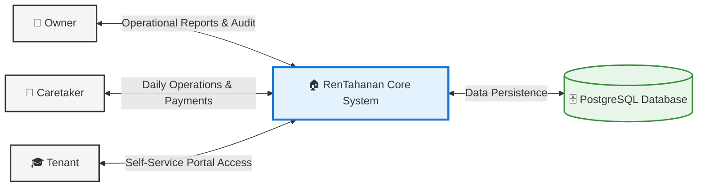

# Context Diagram (Level 0) — Simplified

**Purpose:** High-level system boundary showing only the primary actors and the main system hub.

---

*This simplified view focuses on the "what" (Actors interacting with the Core Hub) rather than the "how" (individual data points), making it perfect for an executive summary or a high-level presentation.*