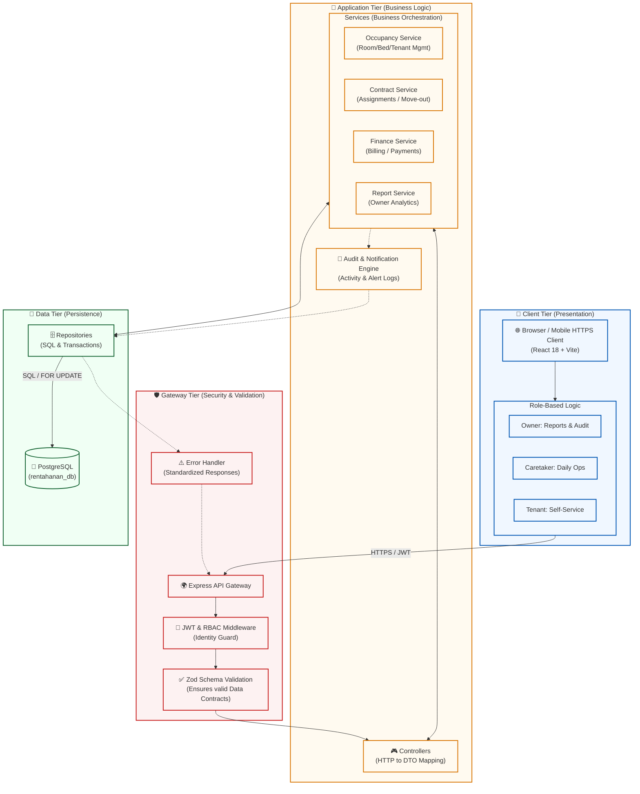

# System Architecture Diagram — RenTahanan

**Generated:** 2026-11-22  
**Alignment:** Requirements ↔ ERD ↔ Class Diagram ↔ Infrastructure  

---

## 1. Architectural Requirements Summary

| Requirement Category | Key Architectural Drivers |
|----------------------|---------------------------|
| **User Stories (US)** | **Role-Based Access:** Isolated portals for Owner, Caretaker, and Tenant roles. |
| **Functional (FR)** | **Transactional Integrity:** SQL Transactions for bed assignments and move-out clearances. |
| **Non-Functional (NFR)** | **Input Security:** Zod Schema Validation for all incoming API requests (NFR-07). |
| **Audit & Alerts** | **Audit Trail:** Automatic activity logging and overdue notification generation (FR-04, FR-06). |

---

## 2. System Architecture Diagram

---

## 3. Communication & Data Integrity Patterns

1.  **Identity Guard (Auth):** Every request must carry a JWT. The **RBAC Middleware** checks the "Role" claim inside the token against the required permission for the route.
2.  **Data Contracts (Zod):** Before reaching a Service, all input is validated by **Zod**. This ensures the **Controllers** only map valid, clean data into **DTOs** (Data Transfer Objects), protecting the logic layer from "dirty" inputs.
3.  **Service Orchestration:** 
    *   **Occupancy Service:** Manages real-time room/bed status toggles.
    *   **Finance Service:** Handles the specific "Exact Payment" logic (FR-03.3).
    *   **Report Service:** Aggregates data for Owner-only financial and occupancy reports.
4.  **Audit & Alerts:** The **Logger Engine** ensures that every sensitive operation is recorded (for the Owner) and that overdue bills automatically trigger entries in the `notifications` table (for the Caretaker).
5.  **Concurrency Control:** The **Repositories** use PostgreSQL row-level locking (`FOR UPDATE`) to ensure that bed assignments are thread-safe and double-bookings are physically impossible.

---

*This architecture is fully synchronized with the `REQUIREMENTS.md`, `ERD.md`, and `IMPLEMENTATION_CLASS_DIAGRAM.md`.*