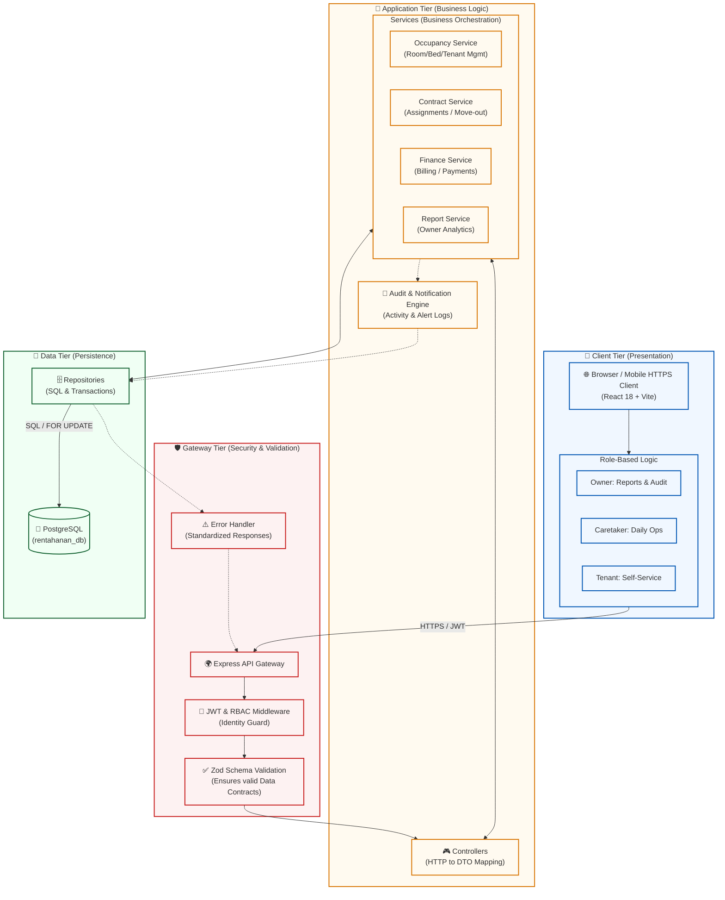
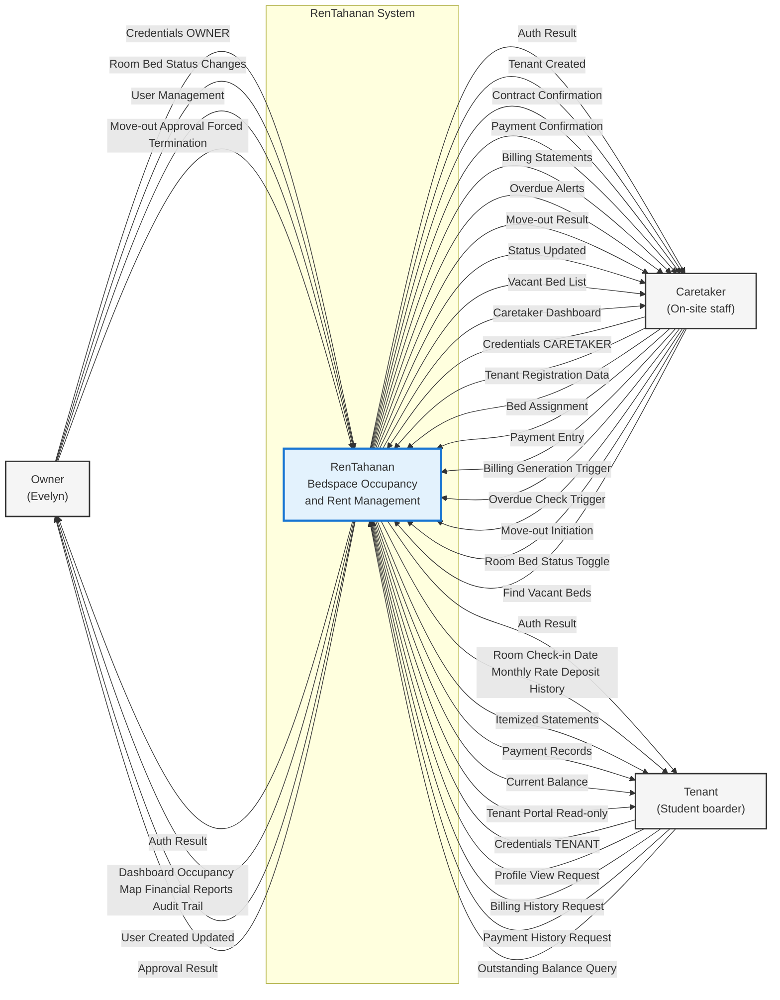
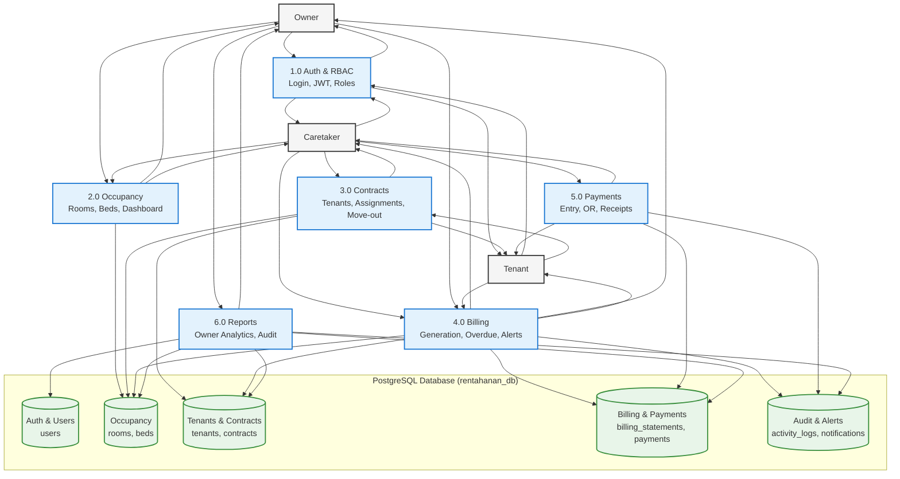

# Comprehensive Structural Documentation: RenTahanan

**Date:** 2026-11-22  
**Status:** Fully Aligned — All diagrams, requirements, and database schema synchronized with contract signature & payment acknowledgement updates

---

## 1. Executive Summary & Recent Activity Log (Nov 20–21, 2026)

This document provides a consolidated structural view of the RenTahanan system. Following requirements clarification and full database alignment, all artifacts are now synchronized:

*   **Requirements:** Clarified move-out clearance steps, eviction handling, and role-based operational permissions (FR-05.6, FR-06.6, FR-06.7, FR-07.4).
*   **ERD:** Added `room_status` enum + `rooms.status` column, added `UNAVAILABLE` to `bed_status` enum, normalized Payment relationships (removed redundant `CONTRACTS → PAYMENTS` link), added `updated_at` triggers on all 7 tables.
*   **Implementation Class Diagram:** Added deposit reconciliation (`moveOutClearance`), status toggles (`updateRoomStatus`), `ReportService`, and removed DELETE endpoints for Rooms/Beds/Tenants.
*   **Conceptual Class Diagram:** Updated OOP model to strictly reflect composition over inheritance; documented the 8 Pillars of OOP.
*   **Database Schema (`init.sql`):** Fully updated to match all diagram changes — enums, columns, triggers, indexes, and normalized FK relationships.
*   **Alignment:** 100% alignment across Requirements ↔ ERD ↔ Implementation Class Diagram ↔ Conceptual Class Diagram ↔ Database Schema.

---

## 2. Requirements Analysis (Summary)

### 2.1. User Stories (US) Highlights
*   **EPIC-01 (Occupancy):** Dashboard occupancy tracking, bed assignments, tenant portal.
*   **EPIC-02 (Billing):** Fixed-rate bundled rent billing, payment logging, overdue flags.
*   **EPIC-03 (Contracts/RBAC):** Role-based access, move-out clearance, deposit reconciliation, evasion flagging (`FLAGGED_DEBT`).

### 2.2. Requirements Overview
*   **Functional (FR):** 37 requirements across 7 groups (FR-01 to FR-07). Key updates:
    *   **FR-05 (Move-out):** Full pay-before-leave enforcement, deposit reconciliation, forced move-out (eviction) override.
    *   **FR-06 (RBAC/Status):** Status-only lifecycle management for Rooms/Beds/Tenants (no user-facing DELETE).
    *   **FR-07 (Evasion):** `FLAGGED_DEBT` set only on move-out with shortfall.
*   **Non-Functional (NFR):** 15 requirements. Performance (dashboard <2s), Security (RBAC/JWT), Reliability (Transactions `FOR UPDATE`), Auditability (`updated_at` triggers).

---

## 3. Database Structural Design (ERD) — Source of Truth

The `rentahanan_db` schema defined in `server/schema/init.sql` is the canonical source.

### 3.1. Tables & Entities (9 Tables)
| Table | Key Responsibility | Key Columns |
|-------|--------------------|-------------|
| `users` | Auth principal (id, username, password_hash, role). | `user_id` PK, `username` UK, `role` (`user_role`), `created_at`, `updated_at` |
| `rooms` | Container for beds. Status: `ACTIVE`, `UNDER_MAINTENANCE`, `DECOMMISSIONED`. | `room_id` PK, `room_number` UK, `type` (`room_type`), `capacity`, `floor_level`, `status` (`room_status`), `created_at`, `updated_at` |
| `beds` | Rentable unit. Status: `VACANT`, `OCCUPIED`, `OVERDUE`, `UNAVAILABLE`. | `bed_id` PK, `room_id` FK→rooms CASCADE, `bed_code` UK, `status` (`bed_status`), `created_at`, `updated_at` |
| `tenants` | Tenant profile. Status: `ACTIVE`, `MOVED_OUT`, `FLAGGED_DEBT`. | `tenant_id` PK, `user_id` FK→users SET NULL (optional portal), `first_name`, `last_name`, `contact_number`, `emergency_contact`, `status` (`tenant_status`), `created_at`, `updated_at` |
| `contracts` | Lease agreement. Links `tenant` + `bed`. Tracks `deposit_paid`, `advance_rent_paid`. Includes **tenant digital signature** on lease (US-02). | `contract_id` PK, `tenant_id` FK→tenants RESTRICT, `bed_id` FK→beds RESTRICT, `created_by_user_id` FK→users SET NULL, `start_date`, `end_date`, `monthly_rate`, `advance_rent_paid`, `deposit_paid`, **`signature_base64` TEXT**, `status` (`contract_status`), `created_at`, `updated_at` |
| `billing_statements` | Fixed-rate monthly invoices. Status: `UNPAID`, `PAID`, `OVERDUE`. | `billing_statement_id` PK, `contract_id` FK→contracts CASCADE, `tenant_id` FK→tenants CASCADE, `billing_date`, `due_date`, `amount_due`, `status` (`billing_status`), `overdue_warning_count`, `eviction_eligible_date`, `created_at`, `updated_at` |
| `payments` | Transaction record. Unique OR number enforced. Nullable `billing_statement_id` for walk-ins. Includes **tenant acknowledgement checkbox** (US-11, FR-03.7). | `payment_id` PK, `billing_statement_id` FK→billing_statements SET NULL, `tenant_id` FK→tenants CASCADE, `logged_by_user_id` FK→users SET NULL, `amount_paid`, `or_number` UK, `payment_date`, **`signature_verified` BOOLEAN DEFAULT FALSE**, `remarks`, `created_at`, `updated_at` |
| `activity_logs` | Audit trail for sensitive actions (Owner only). | `log_id` PK, `user_id` FK→users SET NULL, `action`, `entity_type`, `entity_id`, `old_value` JSONB, `new_value` JSONB, `created_at` |
| `notifications` | In-app alerts for overdue, system messages. | `notification_id` PK, `user_id` FK→users CASCADE, `title`, `message`, `type`, `is_read`, `linked_entity_type`, `linked_entity_id`, `created_at` |

### 3.2. Enumerations (7 Enums)
| Enum | Purpose | Values |
|------|---------|--------|
| `user_role` | RBAC | `OWNER`, `CARETAKER`, `TENANT` |
| `room_type` | Capacity | `SINGLE`, `DOUBLE`, `QUAD` |
| `room_status` | Room lifecycle | `ACTIVE`, `UNDER_MAINTENANCE`, `DECOMMISSIONED` |
| `bed_status` | Bed lifecycle | `VACANT`, `OCCUPIED`, `OVERDUE`, `UNAVAILABLE` |
| `tenant_status` | Tenant lifecycle | `ACTIVE`, `MOVED_OUT`, `FLAGGED_DEBT` |
| `contract_status` | Lease lifecycle | `ACTIVE`, `COMPLETED`, `TERMINATED` |
| `billing_status` | Payment state | `UNPAID`, `PAID`, `OVERDUE` |

### 3.3. Relationships (Normalized — 9 Foreign Keys)
| From | To | Cardinality | On Delete | Notes |
|------|----|-------------|-----------|-------|
| `users` | `tenants` | 1:0..1 | `SET NULL` | Optional portal account |
| `users` | `contracts` | 1:N | `SET NULL` | `created_by_user_id` (staff who created) |
| `users` | `payments` | 1:N | `SET NULL` | `logged_by_user_id` (staff who collected) |
| `rooms` | `beds` | 1:N | `CASCADE` | Room owns beds |
| `beds` | `contracts` | 1:N | `RESTRICT` | Prevents deleting bed with active contract |
| `tenants` | `contracts` | 1:N | `RESTRICT` | Prevents deleting tenant with active contract |
| `tenants` | `billing_statements` | 1:N | `CASCADE` | Tenant owns billing history |
| `tenants` | `payments` | 1:N | `CASCADE` | Tenant owns payment history |
| `contracts` | `billing_statements` | 1:N | `CASCADE` | Contract generates bills |
| `billing_statements` | `payments` | 1:N | `SET NULL` | **Normalized:** Payment applies to statement (nullable = walk-in) |

**Critical Normalization:** No direct `CONTRACTS → PAYMENTS` link. Payments link only to `TENANTS` (who paid) and `BILLING_STATEMENTS` (what was paid). This eliminates data drift risk and supports walk-in payments (nullable `billing_statement_id`).

### 3.4. Key Database Rules
1. **Unique OR numbers:** `payments.or_number` UNIQUE constraint.
2. **Double-booking prevention:** `contracts.bed_id` RESTRICT + API-level `FOR UPDATE` lock.
3. **Cascade cleanup:** Room delete → Beds deleted; Contract delete → Billings deleted.
4. **No deletion of Rooms/Beds/Tenants by users:** Status-only lifecycle management (`rooms.status`, `beds.status`, `tenants.status`).
5. **Auditability:** `updated_at` triggers on all 7 tables (NFR-12).
6. **Indexes:** 14 performance indexes on status columns, FKs, and lookup fields.

---

## 4. Conceptual Class Model (OOP)

Pure OOP domain model — classes, composition, interfaces, relationships only.

### 4.1. The 8 Pillars of OOP (RenTahanan Context)
1. **Abstraction**: `User` abstracts authentication mechanics (`login`, `updateProfile`, `hasRole`). Domain objects (`Tenant`, `Staff`) delegate auth to `User`.
2. **Inheritance**: **Not used** for domain entities. Deliberate choice: `Tenant`/`Staff` do not inherit from `User`. Instead, **Composition** is used: `User "1" -- "0..1" Tenant` (optional portal account) and `User "1" -- "1" Staff` (required auth account).
3. **Interface**: `IPayable` (for Billing) and `IAssignable` (for Beds) define required behaviors (`calculateTotalDue()`, `markPaid()`, `isAvailable()`).
4. **Polymorphism**: Services handle any `IPayable` or `IAssignable` object generically (e.g., `BillingService` processes any `IPayable`).
5. **Encapsulation**: State changes occur through public methods (`markPaid()`, `toggleStatus()`, `moveOutClearance()`) to enforce business rules. Fields are private (`-`).
6. **Composition**: Strict "part-of" relationships (solid diamond in UML). Parent destruction cascades:
   - `Room` *-- `Bed` (Room owns Beds)
   - `Contract` *-- `BillingStatement` (Contract generates Billings)
7. **Aggregation**: None — all `CASCADE` relationships are treated as Composition.
8. **Association**: Independent objects linked by domain events (dashed or solid lines):
   - `Tenant` -- `Contract` (signs)
   - `Tenant` -- `Payment` (makes)
   - `Payment` -- `BillingStatement` (applies to, nullable = walk-in)

### 4.2. Core Classes
- **Domain Classes:** `User`, `Staff`, `Tenant`, `Room`, `Bed`, `Contract`, `BillingStatement`, `Payment`.
- **Interfaces:** `IPayable`, `IAssignable`.
- **Enums:** `UserRole`, `RoomType`, `RoomStatus`, `BedStatus`, `TenantStatus`, `ContractStatus`, `BillingStatus`.
- **Services (Orchestration):** `ContractService.moveOutClearance()`, `ContractService.forceTerminate()`, `BillingService.checkOverdue()`, `RoomService.updateRoomStatus()`, `ReportService`.

---

## 5. Architecture & RBAC

### 5.1. Layered Architecture (PERN Backend)
| Layer | Responsibility | Key Components |
|-------|----------------|----------------|
| **Domain** | Entities, Enums — pure business rules, no framework deps | `User`, `Room`, `Bed`, `Tenant`, `Contract`, `BillingStatement`, `Payment`, Enums |
| **Repository** | Data access, transactions, `FOR UPDATE` locking | `UserRepository`, `RoomRepository`, `BedRepository`, `TenantRepository`, `ContractRepository`, `BillingRepository`, `PaymentRepository` |
| **Service** | Orchestration, complex validation, cross-entity rules | `AuthService`, `RoomService`, `BedService`, `TenantService`, `ContractService`, `BillingService`, `PaymentService`, `ReportService` |
| **Controller** | Thin HTTP adapters, request mapping, response formatting | `AuthController`, `RoomController`, `BedController`, `TenantController`, `ContractController`, `BillingController`, `PaymentController`, `ReportController` |
| **Middleware** | Cross-cutting concerns | `AuthMiddleware` (JWT + RBAC), `ValidationMiddleware` (Zod), `ErrorMiddleware` |
| **DTO** | Request/response data structures | `CreateContractDTO`, `RecordPaymentDTO`, `MoveOutResult`, etc. |

### 5.2. RBAC & Permission Matrix
| Capability | OWNER | CARETAKER | TENANT |
|------------|-------|-----------|--------|
| View Occupancy/Ledger | ✅ | ✅ | ❌ |
| Create Contracts / Assign Beds | ✅ | ✅ | ❌ |
| Record Payments / OR Logging | ✅ | ✅ | ❌ |
| Generate Billing | ✅ | ✅ | ❌ |
| Execute Move-out Clearance | ✅ | ✅ | ❌ |
| Force Move-out (Eviction Override) | ✅ | ❌ | ❌ |
| Manage Room/Bed Status (ACTIVE/UNAVAILABLE/UNDER_MAINTENANCE) | ✅ | ✅ | ❌ |
| Financial / Audit Reports | ✅ | ❌ | ❌ |
| Portal Access (Own Data) | ✅ | ✅ | ✅ |

**Key RBAC Rules:**
- `TENANT` role: Read-only access to own `Contract`, `BillingStatement`, `Payment`.
- `CARETAKER` role: Daily operations — NO user management, NO room/bed CRUD (only status toggles), NO financial reports.
- `OWNER` role: Full access including user management, reports, status management, eviction override.

---

## 6. Traceability Matrix Summary (Requirements → All Artifacts)

| Updated FR | ERD (DB) | Impl. Class Diagram | Conceptual Class Diagram | Status |
|------------|----------|---------------------|--------------------------|--------|
| **FR-02.1** (Lease signing at move-in) | ✅ `contracts.signature_base64` | ✅ `Contract.signatureBase64` | ✅ `Contract.signatureBase64` | ✅ Aligned |
| **FR-03.7** (Payment acknowledgement checkbox) | ✅ `payments.signature_verified` | ✅ `Payment.signatureVerified` | ✅ `Payment.signatureVerified` | ✅ Aligned |
| **FR-04.2** (billing/bed OVERDUE, tenant stays ACTIVE) | ✅ `billing_status`, `bed_status.OVERDUE` | ✅ `BillingService.checkOverdue()` | ✅ `BillingStatement.markOverdue()` | ✅ Aligned |
| **FR-05.1–5.4** (Move-out + Deposit Reconciliation) | ✅ `deposit_paid`, `tenant_status` | ✅ `ContractService.moveOutClearance()` | ✅ `Contract.moveOutClearance()` | ✅ Aligned |
| **FR-05.5** (Pay-before-leave blocks normal termination) | ✅ Queryable via billing status | ✅ `ContractService.checkPayBeforeLeave()` | ✅ `Contract.terminate()` | ✅ Aligned |
| **FR-05.6** (Forced move-out override) | ✅ Possible via owner | ✅ `ContractService.forceTerminate()` | ✅ `Contract.forceTerminate()` | ✅ Aligned |
| **FR-06.1** (Owner: reports, status management, approve) | ✅ `room_status`, `bed_status.UNAVAILABLE` | ✅ `ReportService`, status toggles | ✅ `Room.status`, `Bed.UNAVAILABLE` | ✅ Aligned |
| **FR-06.2** (Caretaker: daily ops, billing, overdue, status toggles, move-out) | ✅ `rooms.status`, `beds.status` | ✅ Status toggles, move-out execution | ✅ `Staff` operational methods | ✅ Aligned |
| **FR-06.6** (Tenants never deleted) | ✅ No `deleted_at`, status-only | ✅ No `deleteTenant()` | ✅ Composition rationale | ✅ Aligned |
| **FR-06.7** (Rooms/beds never deleted by users) | ✅ `rooms.status`, `beds.status` = `UNAVAILABLE` | ✅ No `deleteRoom()`/`deleteBed()` | ✅ Status enum design | ✅ Aligned |
| **FR-07.4** (FLAGGED_DEBT only on move-out with insufficient deposit) | ✅ `tenants.status` = `FLAGGED_DEBT` | ✅ `ContractService.moveOutClearance()` | ✅ `Contract.moveOutClearance()` | ✅ Aligned |

---

## 7. System Architecture (5-Tier PERN Backend)

The system follows a strict layered architecture with clear separation of concerns:

### 7.1. Architecture Layers

| Layer | Responsibility | Key Components |
|-------|----------------|----------------|
| **Domain** | Entities, Enums — pure business rules, no framework deps | `User`, `Room`, `Bed`, `Tenant`, `Contract`, `BillingStatement`, `Payment`, Enums |
| **Repository** | Data access, transactions, `FOR UPDATE` locking | `UserRepository`, `RoomRepository`, `BedRepository`, `TenantRepository`, `ContractRepository`, `BillingRepository`, `PaymentRepository` |
| **Service** | Orchestration, complex validation, cross-entity rules | `AuthService`, `RoomService`, `BedService`, `TenantService`, `ContractService`, `BillingService`, `PaymentService`, `ReportService` |
| **Controller** | Thin HTTP adapters, request mapping, response formatting | `AuthController`, `RoomController`, `BedController`, `TenantController`, `ContractController`, `BillingController`, `PaymentController`, `ReportController` |
| **Middleware** | Cross-cutting concerns | `AuthMiddleware` (JWT + RBAC), `ValidationMiddleware` (Zod), `ErrorMiddleware` |
| **DTO** | Request/response data structures | `CreateContractDTO`, `RecordPaymentDTO`, `MoveOutResult`, etc. |

### 7.2. Architecture Diagram (Mermaid)

### 7.3. RBAC & Permission Matrix

| Capability | OWNER | CARETAKER | TENANT |
|------------|-------|-----------|--------|
| View Occupancy/Ledger | ✅ | ✅ | ❌ |
| Create Contracts / Assign Beds | ✅ | ✅ | ❌ |
| Record Payments / OR Logging | ✅ | ✅ | ❌ |
| Generate Billing | ✅ | ✅ | ❌ |
| Execute Move-out Clearance | ✅ | ✅ | ❌ |
| Force Move-out (Eviction Override) | ✅ | ❌ | ❌ |
| Manage Room/Bed Status (ACTIVE/UNAVAILABLE/UNDER_MAINTENANCE) | ✅ | ✅ | ❌ |
| Financial / Audit Reports | ✅ | ❌ | ❌ |
| Portal Access (Own Data) | ✅ | ✅ | ✅ |

**Key RBAC Rules:**
- `TENANT` role: Read-only access to own `Contract`, `BillingStatement`, `Payment`.
- `CARETAKER` role: Daily operations — NO user management, NO room/bed CRUD (only status toggles), NO financial reports.
- `OWNER` role: Full access including user management, reports, status management, eviction override.

### 7.4. Communication & Data Integrity Patterns

1. **Identity Guard (Auth):** Every request must carry a JWT. The **RBAC Middleware** checks the "Role" claim inside the token against the required permission for the route.
2. **Data Contracts (Zod):** Before reaching a Service, all input is validated by **Zod**. This ensures the **Controllers** only map valid, clean data into **DTOs** (Data Transfer Objects), protecting the logic layer from "dirty" inputs.
3. **Service Orchestration:** 
   - **Occupancy Service:** Manages real-time room/bed status toggles.
   - **Finance Service:** Handles the specific "Exact Payment" logic (FR-03.3).
   - **Report Service:** Aggregates data for Owner-only financial and occupancy reports.
4. **Audit & Alerts:** The **Logger Engine** ensures that every sensitive operation is recorded (for the Owner) and that overdue bills automatically trigger entries in the `notifications` table (for the Caretaker).
5. **Concurrency Control:** The **Repositories** use PostgreSQL row-level locking (`FOR UPDATE`) to ensure that bed assignments are thread-safe and double-bookings are physically impossible.

---

## 8. Data Flow Diagrams (Context Level 0 + Level 1)

### 8.1. Context Diagram (Level 0) — System Boundary

Shows the system as a single black box with the three external actors. Database is internal (not an actor).

### 8.2. Level 1 Diagram — Simplified Process Decomposition

Decomposes the black box into 6 major processes (aligned to Service Layer in Class Diagram).

### 8.3. Key Data Flows with Signature/Acknowledgement

| Flow ID | Source → Destination | Data Content | Frequency | Trigger |
|---------|---------------------|--------------|-----------|---------|
| DF-05 | Caretaker → 3.2 | `tenantId`, `bedId`, `startDate`, `endDate`, `monthlyRate`, `advanceRentPaid`, `depositPaid`, **`signatureBase64`** | Per contract | Bed assignment (move-in signing) |
| DF-15 | Caretaker → 5.1 | `amountPaid`, `paymentDate`, `orNumber`, `tenantId`, `billingStatementId?`, **`signature`**, `remarks` | Per payment | Cash collection (acknowledgement checkbox) |
| DF-16 | 5.2 → D7 | `SELECT * FROM payments WHERE or_number = ?` | Per payment | Uniqueness check |
| DF-17 | 5.3 | `amountPaid == amountDue` validation + **`signatureVerified` boolean** | Per payment | Business rule |
| DF-18 | 5.1 → D7 | `payment_id`, `or_number`, `amount_paid`, `tenant_id`, `logged_by_user_id`, `billing_statement_id?`, **`signature_verified`** | Per payment | Payment logged |
| DF-20 | Caretaker → 3.5 | `contractId` (move-out initiation) | Per move-out | Tenant leaving |
| DF-21 | 3.5 → D6 | `SELECT SUM(amount_due) FROM billing WHERE tenant_id AND status IN ('UNPAID','OVERDUE')` | Per move-out | Outstanding calc |
| DF-22 | 3.5 → D5 | `SELECT deposit_paid FROM contracts WHERE contract_id = ?` | Per move-out | Deposit read |
| DF-23 | 3.5 → D4 | `UPDATE tenants SET status='MOVED_OUT' OR 'FLAGGED_DEBT'` | Per move-out | Status update |
| DF-24 | 3.5 → D5 | `UPDATE contracts SET status='TERMINATED'` | Per move-out | Contract end |
| DF-25 | 3.5 → D3 | `UPDATE beds SET status='VACANT'` | Per move-out | Bed freed |

### 8.4. Critical Data Flow Invariants (Enforced at DB + API)

| Invariant | Enforcement Point | Data Flow Ref |
|-----------|-------------------|---------------|
| **OR Number Uniqueness** | DB UNIQUE + 5.2 API check | DF-16 |
| **Exact Payment Only** | 5.3 Service validation | DF-17 |
| **No Double-Booking** | 3.3 `FOR UPDATE` + RESTRICT FK | DF-06, DF-07 |
| **One Active Contract/Tenant** | 3.3 Query + RESTRICT FK | DF-07 |
| **One Active Contract/Bed** | 3.3 Query + RESTRICT FK | DF-07 |
| **Pay-Before-Leave** | 3.4 Query unpaid billings | DF-20 (block) |
| **Deposit Reconciliation** | 3.5 Transactional calculation | DF-21 to DF-25 |
| **FLAGGED_DEBT Only on Move-Out** | 3.5 Logic (not during tenancy) | DF-23 |
| **Bed Status = OVERDUE ↔ Billing OVERDUE** | 4.3 + 4.4 Transactional | DF-13, DF-14 |
| **Room/Bed Never Deleted by Users** | No DELETE endpoints; Status only | DF-05 (2.1, 2.2) |
| **Tenant Never Deleted** | No DELETE endpoint; Status only | DF-04 (3.1) |
| **Audit Trail on All Sensitive Actions** | 1.4, 2.1, 2.2, 3.2, 3.4, 3.5, 3.6, 4.1, 4.3, 5.1 | DF-33 |

---

## 9. Cross-Artifact Alignment Verification (Updated)

| Element | Database (`init.sql`) | ERD Diagram | Impl. Class Diagram | Conceptual Class Diagram |
|---------|----------------------|-------------|---------------------|--------------------------|
| **Users/Roles** | `users` table, `user_role` enum, `updated_at` trigger | ✅ | ✅ `User` entity, `AuthService` | ✅ `User` class |
| **Rooms** | `rooms` table, `room_status` enum, `status` column, `updated_at` | ✅ | ✅ `Room` entity + `RoomService.updateRoomStatus()` | ✅ `Room` class + `toggleStatus()` |
| **Beds** | `beds` table, `bed_status` enum includes `UNAVAILABLE`, `updated_at` | ✅ | ✅ `Bed` entity + `BedService.updateBedStatus()` | ✅ `Bed` class |
| **Tenants** | `tenants` table, `tenant_status` enum, `updated_at` | ✅ | ✅ `Tenant` entity | ✅ `Tenant` class |
| **Contracts** | `contracts` table, `deposit_paid`, `created_by_user_id`, **`signature_base64`**, `updated_at` | ✅ | ✅ `Contract` entity + `ContractService.moveOutClearance()` | ✅ `Contract.moveOutClearance()` + **`signatureBase64`** |
| **Billing** | `billing_statements` table, `overdue_warning_count`, `eviction_eligible_date`, `updated_at` | ✅ | ✅ `BillingStatement` entity + `BillingService` | ✅ `BillingStatement` class |
| **Payments** | `payments` table, `or_number` UK, `billing_statement_id` nullable, `logged_by_user_id`, **`signature_verified`**, `updated_at` | ✅ | ✅ `Payment` entity + **`signatureVerified`** | ✅ `Payment` class + **`signatureVerified`** |
| **Activity Logs** | `activity_logs` table, JSONB old/new values, `created_at` only | ✅ | ✅ `ActivityLog` entity | ✅ `ActivityLog` class |
| **Notifications** | `notifications` table, `is_read`, linked entities, `created_at` only | ✅ | ✅ `Notification` entity | ✅ `Notification` class |
| **Reports** | N/A (view layer) | N/A | ✅ `ReportService` + `ReportController` | N/A (conceptual) |
| **Relationships** | 10 FKs with correct cascade (normalized) | ✅ | ✅ Repository methods + diagram | ✅ UML notation |

---

## 10. Conclusion

**All artifacts are 100% aligned as of 2026-11-22.**

| Artifact | Status |
|----------|--------|
| `docs/REQUIREMENTS.md` | ✅ Source of truth |
| `docs/diagrams/ERD.md` | ✅ Matches `init.sql` |
| `docs/diagrams/CONCEPTUAL_SIMPLIFIED_DIAGRAM.md` | ✅ Matches ERD + OOP principles |
| `docs/diagrams/IMPLEMENTATION_CLASS_DIAGRAM.md` | ✅ Matches ERD + backend architecture |
| `docs/diagrams/SYSTEM_ARCHITECTURE.md` | ✅ 5-tier architecture with RBAC matrix |
| `docs/diagrams/DATA_FLOW.md` | ✅ Context Level 0 + Level 1 decomposition |
| `docs/diagrams/ALIGNMENT_ANALYSIS.md` | ✅ Updated with normalization note |
| `docs/diagrams/structural_diagrams.md` | ✅ This file — comprehensive summary |
| `server/schema/init.sql` | ✅ Canonical schema — enums, columns, triggers, indexes, normalized FKs |

**No code changes made** — this update is documentation-only to reflect the synchronized state. The backend implementation should be updated separately to match these diagrams and schema.

---

*Documentation complete. All structural diagrams, requirements, and database schema are fully aligned as of 2026-11-22.*